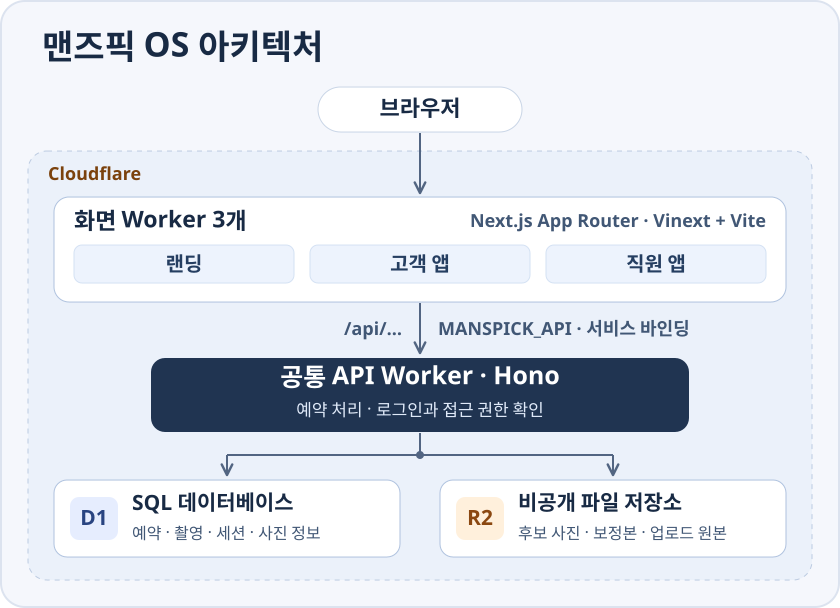

# 맨즈픽 OS

맨즈픽 OS는 남성 스타일링·프로필 촬영 서비스의 주문, 설문, 디렉터 배정과 일정 확정을 관리합니다. 고객은 희망 일정을 제출하고, 배정된 디렉터는 그중 하나를 골라 촬영 시간과 장소를 확정합니다.

## 로컬 실행

Node.js 24.22.0 이상인 24.x 또는 26.12.0 이상인 26.x와 Yarn 4.18.1을 사용합니다. 저장소 루트에서 실행합니다.

```sh
yarn install --immutable
yarn db:init
yarn dev
```

`yarn db:init`은 빈 로컬 D1에 스키마와 체험 데이터를 넣는 최초 1회 명령입니다. 이후에는 `yarn dev`로 세 화면 앱과 API를 함께 시작합니다. 기본 로컬 설정은 Cloudflare 계정이나 환경 변수 없이 동작하며 데이터는 `.local/state`에 저장됩니다. 기존 DB에 스키마 변경을 적용하는 명령은 [서버 README](apps/server/README.md#환경과-검사)에 있습니다.

| 서비스                                        | 로컬 주소                                                     | 개별 실행                | 담당 기능                             |
| --------------------------------------------- | ------------------------------------------------------------- | ------------------------ | ------------------------------------- |
| [랜딩](apps/frontend-landing-page/README.md)  | [localhost:3000](http://localhost:3000)                       | `yarn dev:landing-page`  | 서비스 소개, 패키지 추천, 상담        |
| [고객](apps/frontend-customer-page/README.md) | [localhost:3001/start](http://localhost:3001/start)           | `yarn dev:customer-page` | 예약 신청, 수납 확인, 설문, 촬영 안내 |
| [어드민](apps/frontend-admin-page/README.md)  | [localhost:3002](http://localhost:3002)                       | `yarn dev:admin-page`    | 고객·직원 관리, 배정, 일정 확정, 지표 |
| [공통 API](apps/server/README.md)             | [127.0.0.1:8787/api/health](http://127.0.0.1:8787/api/health) | `yarn dev:server`        | 로그인·권한, 예약 처리, D1·R2 접근    |
| [Empty](apps/frontend-empty-page/)            | [localhost:3003](http://localhost:3003)                       | `yarn dev:empty`         | 공통 상단 바를 보는 정적 앱           |
| [Storybook](packages/design-system/README.md) | [127.0.0.1:6006](http://127.0.0.1:6006/)                      | `yarn storybook`         | 공용 UI 예제와 상호작용 검사          |

화면 앱을 개별 실행할 때는 `yarn dev:server`도 함께 실행합니다. Empty와 Storybook은 단독으로 실행할 수 있습니다. 앱 간 이동과 세션을 확인할 때는 세 화면 모두 `localhost`로 접속합니다.

## 체험 데이터

[고객 앱 홈](http://localhost:3001)에서 샘플을 고르면 개인 링크와 확인 번호를 볼 수 있습니다. [입금 대기 샘플](http://localhost:3001/s/demo-payment-access)은 휴대전화 뒤 4자리 `1001`, [촬영 준비 샘플](http://localhost:3001/s/demo-preparation-access)은 `1002`입니다. [어드민](http://localhost:3002)에서는 가상 직원의 역할을 골라 배정과 접근 범위를 확인합니다.

## 저장소 구조



랜딩·고객·어드민은 Next.js App Router를 Vinext/Vite로 빌드합니다. 각 화면의 `/api`는 Cloudflare Service Binding인 `MANSPICK_API`를 통해 NestJS Worker에 요청을 전달합니다. 서버는 세션과 촬영별 권한을 확인하고 예약·설문은 D1에, 사진 파일은 비공개 R2에 저장합니다.

### 공용 패키지

| 공개 경로                                                      | 언제 사용하는가                                                                                                                                                                                                                            |
| -------------------------------------------------------------- | ------------------------------------------------------------------------------------------------------------------------------------------------------------------------------------------------------------------------------------------ |
| [@manspick/design-system](packages/design-system/README.md)    | 화면을 만들 때 공통 컴포넌트·패턴·토큰과 아이콘·폰트·이미지를 가져옵니다.                                                                                                                                                                  |
| [@manspick/domain](packages/domain/src/index.ts)               | 앱과 서버가 촬영 단계·전이(`statusInfo`, `assertTransition`), 예약 슬롯·기한(`requiredSlots`, `holdExpiry`), 상품 수량·설문 응답을 같은 규칙으로 검사합니다. 새 예약에는 현재 `OperationsPolicy`를 전달하고, 생략하면 기본값을 사용합니다. |
| [@manspick/contracts](packages/contracts/src/index.ts)         | 앱과 서버가 `import type`으로 예약·촬영·세션·지표 DTO를 공유합니다. `BookingResultDTO`의 `bookingAccess`는 공개 테스트의 신규 예약, `localAccess`는 로컬 시연용입니다. 기존 예약 스냅샷에는 상품 옵션 규칙이 없을 수 있습니다.             |
| [@manspick/web/client](packages/web/src/client/index.ts)       | 브라우저에서 `api`·`action`으로 같은 앱의 `/api`를 호출하고 `ApiError`로 실패를 처리합니다. `visitId`와 `trackEvent`는 탭별 방문과 행동을 기록합니다.                                                                                      |
| [@manspick/web/format](packages/web/src/format/index.ts)       | 브라우저와 서버에서 `money`로 원화를, `dateTime`으로 서울 시간을 표시합니다. 좁은 카드에는 `dateTime(value, 'compact')`를 씁니다.                                                                                                          |
| [@manspick/web/proxy](packages/web/src/proxy/proxy-request.ts) | Next 서버의 Route Handler가 앱 종류를 고정해 요청을 전달합니다. 고객 앱은 `proxyRequest(request, 'user')`를 사용합니다.                                                                                                                    |

랜딩 프록시는 `/api/catalog`, `/api/health`, `POST /api/analytics/events`만 허용합니다. 로컬 Worker도 서비스 바인딩을 사용하며, Worker 밖의 Node 테스트는 `MANSPICK_LOCAL_API=true`로 `127.0.0.1:8787`에 연결할 수 있습니다.

## Cloudflare 배포

서버의 D1·R2·이메일 설정은 [운영 설정 예시](infra/wrangler.production.example.jsonc)를 `infra/wrangler.production.jsonc`로 복사해 준비합니다. 화면 앱마다 `cloudflare.config.ts`의 `MANSPICK_API`가 운영 서버 Worker를 가리키게 합니다. 랜딩의 `NEXT_PUBLIC_CUSTOMER_APP_ORIGIN`·`NEXT_PUBLIC_ADMIN_APP_ORIGIN`과 고객의 `NEXT_PUBLIC_LANDING_APP_ORIGIN`은 빌드 환경에서 지정합니다.

운영 배포 시 서버는 `yarn wrangler login`, 화면 앱은 `yarn cf:login`으로 인증합니다. 대상 DB에 스키마를 적용하고 `yarn deploy server`를 실행한 뒤 `yarn deploy landing-page`, `yarn deploy customer-page`, `yarn deploy admin-page`로 필요한 앱을 배포합니다. 공개 테스트용 Worker와 가상 고객 링크는 [서버의 통합 테스트 환경](apps/server/README.md#통합-테스트-환경)에 정리했습니다.

테스트 환경은 `yarn deploy public-server-test` 후 필요한 화면을 `yarn deploy landing-page-test`, `yarn deploy customer-page-test`, `yarn deploy admin-page-test`로 배포합니다. 앱별 테스트 주소는 [랜딩](https://manspick-landing-test.winningant8.workers.dev), [고객](https://manspick-customer-test.winningant8.workers.dev), [어드민](https://manspick-admin-test.winningant8.workers.dev), [Empty](https://manspick-empty-test.winningant8.workers.dev), [Storybook](https://manspick-storybook-test.winningant8.workers.dev)입니다.

## 개발 문서

- [제품 요구사항](docs/product-requirements.md) — 고객 흐름, 계약 범위, 지표와 검수 기준
- [DB 설계](docs/database.md) — 예약·설문·촬영 데이터의 관계와 제약
- [AI 작업 규칙](AGENTS.md) — 패키지 재사용 순서, 코드 경계, 검증 방법

저장소 전체 검사는 루트의 `yarn typecheck`, `yarn lint`, `yarn test`, `yarn build`로 실행합니다. 화면별 브라우저 검사 방법은 각 앱 README에 있습니다.
