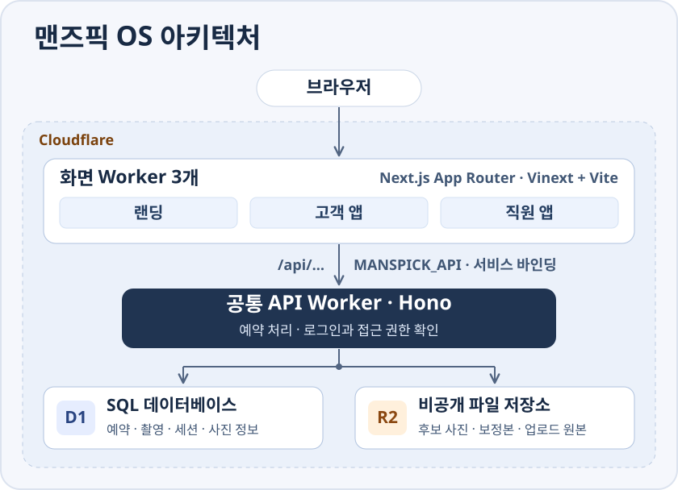

# 맨즈픽 OS

남성 스타일링·프로필 촬영의 예약부터 준비, 사진 선택·보정, 후기·원본 전달까지 연결하는 시스템입니다. 랜딩 페이지에서 서비스를 소개하고, 고객 페이지에서 예약과 촬영 진행을 확인하며, 어드민 페이지에서 같은 예약을 처리합니다.

## 로컬 실행

### 처음 실행할 때

Node.js 24.22.0 이상인 24.x 또는 26.12.0 이상인 26.x와 Yarn `4.18.1`을 사용합니다. `yarn`을 찾을 수 없으면 `corepack enable`로 활성화합니다. [Yarn Corepack 안내](https://yarnpkg.com/corepack)

`package.json`과 `yarn.lock`이 있는 저장소 루트에서 순서대로 실행합니다.

```sh
yarn install --immutable
yarn db:init
yarn dev
```

`yarn db:init`은 **빈 로컬 DB에서 처음 한 번만** 실행합니다. D1 테이블을 만들고 체험 데이터를 넣습니다. 다음부터는 `yarn dev`로 시작합니다. D1·R2 데이터는 `.local/state`에 보관되며 로컬 실행에 Cloudflare 계정은 필요 없습니다. 기존 DB에 스키마 변경만 적용하려면 [서버 README](apps/server/README.md#환경과-검사)의 로컬 마이그레이션 명령을 사용합니다.

### 앱별 실행 명령과 접속 주소

`yarn dev`는 랜딩·고객·어드민 페이지와 공통 서버를 한꺼번에 실행합니다. 페이지 하나만 실행할 때는 첫 번째 터미널에서 `yarn dev:server`로 공통 서버를 켜고 두 번째 터미널에서 해당 페이지를 실행합니다. 공통 서버는 NestJS·Express를 Cloudflare Workers의 Node HTTP 호환 계층에서 실행하며, Wrangler 로컬 포트는 `8787`입니다. Empty와 Storybook은 서버·DB 없이 따로 실행합니다.

| 서비스                  | 개별 실행 명령           | 로컬 주소                                                                            | Cloudflare 주소                                                                                            |
| ----------------------- | ------------------------ | ------------------------------------------------------------------------------------ | ---------------------------------------------------------------------------------------------------------- |
| 랜딩 페이지             | `yarn dev:landing-page`  | [localhost:3000](http://localhost:3000)                                              | 공개 배포 주소 미확인                                                                                      |
| 고객 페이지             | `yarn dev:customer-page` | [localhost:3001](http://localhost:3001)                                              | 공개 배포 주소 미확인                                                                                      |
| 어드민 페이지           | `yarn dev:admin-page`    | [localhost:3002](http://localhost:3002)                                              | [manspick-admin-test.winningant8.workers.dev](https://manspick-admin-test.winningant8.workers.dev)         |
| Empty                   | `yarn dev:empty`         | [localhost:3003](http://localhost:3003)                                              | [manspick-empty-test.winningant8.workers.dev](https://manspick-empty-test.winningant8.workers.dev)         |
| 공통 서버               | `yarn dev:server`        | [공통 서버 · 8787](http://127.0.0.1:8787/api/health)                                 | 비공개 · [관리자 테스트에서 상태 확인](https://manspick-admin-test.winningant8.workers.dev/api/health)     |
| 디자인 시스템 Storybook | `yarn storybook`         | [127.0.0.1:6006](http://127.0.0.1:6006/?path=/story/overview-design-system--catalog) | [manspick-storybook-test.winningant8.workers.dev](https://manspick-storybook-test.winningant8.workers.dev) |

화면 앱 간 이동과 세션을 확인할 때는 브라우저에서 `localhost` 주소를 일관되게 사용합니다. API 요청이 실패하면 위의 로컬 상태 확인 링크를 먼저 엽니다. Cloudflare 열에는 저장소에 기록된 테스트 주소를 표시했습니다. 운영 도메인은 배포 설정에서 지정합니다.

## 환경 변수 (`.env`)

**기본 로컬 실행에는 `.env`가 필요 없습니다.** 페이지 주소는 `localhost:3000`·`3001`·`3002`를 사용하며, 로컬 D1·R2와 `LOCAL_DEMO=true`는 [로컬 서버 설정](infra/wrangler.jsonc)에 이미 지정되어 있습니다.

주소를 바꾸거나 운영에 배포할 때만 아래 파일을 각 앱 폴더에 만듭니다. 예시 도메인을 실제 주소로 바꾸고 **빌드·배포 전에** 저장합니다.

`apps/landing/.env.local` — 랜딩 페이지의 고객·어드민 이동 주소

```dotenv
NEXT_PUBLIC_CUSTOMER_APP_ORIGIN=https://customer.example.com
NEXT_PUBLIC_ADMIN_APP_ORIGIN=https://admin.example.com
```

`apps/user/.env.local` — 고객 페이지에서 돌아갈 랜딩 주소

```dotenv
NEXT_PUBLIC_LANDING_APP_ORIGIN=https://www.example.com
```

어드민·Empty·Storybook에는 별도의 필수 `.env` 항목이 없습니다. `NEXT_PUBLIC_*` 값은 브라우저에 공개되므로 주소만 넣고 비밀 키는 넣지 않습니다.

공통 서버의 운영 설정은 `.env` 대신 `infra/wrangler.production.jsonc`에 둡니다. [설정 예시](infra/wrangler.production.example.jsonc)를 복사한 뒤 다음 값을 지정합니다.

| 위치   | 항목                      | 넣을 값                                           |
| ------ | ------------------------- | ------------------------------------------------- |
| `vars` | `STAFF_APP_ORIGIN`        | 경로를 제외한 어드민 페이지의 HTTPS 주소          |
| `vars` | `CUSTOMER_APP_ORIGIN`     | 경로를 제외한 고객 페이지의 HTTPS 주소            |
| `vars` | `STAFF_EMAIL_DOMAIN`      | 직원 이메일의 회사 도메인, 예: `example.com`      |
| `vars` | `STAFF_EMAIL_FROM`        | Cloudflare에서 승인된 로그인 메일 발신 주소       |
| 바인딩 | `DB` · `BUCKET` · `EMAIL` | 실제 D1 이름·ID, 비공개 R2 버킷, 이메일 발송 연결 |

운영에서는 `LOCAL_DEMO`·`ADMIN_TEST_DEMO`를 켜지 않습니다. 직원 로그인에 사용할 해당 도메인의 활성 대표 계정도 DB에 준비합니다.

## Cloudflare 배포

모든 명령은 저장소 루트에서 실행합니다.

1. **로그인:** 서버·Empty·Storybook은 `yarn wrangler login`, 세 페이지는 `yarn cf:login`을 실행합니다.
2. **설정:** 위의 환경 변수와 운영 서버 설정을 준비합니다. 각 앱의 `cloudflare.config.ts`에서 Worker 이름·공개 도메인을 정하고, `MANSPICK_API`를 운영 서버 Worker에 연결합니다. 기본 연결 대상은 `manspick-api-local`이므로 바꿔야 합니다. D1 마이그레이션도 먼저 적용합니다.
3. **배포:** 공통 서버를 먼저 배포한 뒤 필요한 페이지를 배포합니다. 페이지 명령은 빌드도 함께 실행합니다.

```sh
yarn deploy server
yarn deploy landing-page
yarn deploy customer-page
yarn deploy admin-page
```

테스트 환경은 `yarn deploy server-test` → `yarn deploy admin-page-test` 순서입니다. Empty와 Storybook은 각각 `yarn deploy empty`, `yarn deploy storybook`으로 빌드·배포합니다. 배포 후 각 페이지의 `/api/health`로 서버 연결을 확인합니다.

현재 API의 원격 설정은 비공개 `manspick-api-test`이며 관리자 테스트 앱에서 Service Binding으로 접근합니다. 운영 서버 설정은 예시만 있으므로 `yarn deploy server`는 실제 `infra/wrangler.production.jsonc`를 준비한 뒤 사용합니다. Nest 전환 검증은 `yarn test`와 서버 빌드, Wrangler 로컬 D1·R2 검사 후 배포한 Worker의 상태·인증·파일 요청까지 확인합니다. [전환 계획과 검증 기록](docs/reference/21-nestjs-migration.md)

DB 준비와 상세 설정은 [DB와 아키텍처](docs/REVIEW.md)와 [서버 설정 안내](apps/server/README.md#환경과-검사)를 참고합니다.

## 체험 데이터

실제 고객 정보 대신 테스트 이름·전화번호·이미지를 사용합니다. 고객 앱 홈에서도 다음 샘플을 선택할 수 있습니다. 각 개인 페이지에서 휴대전화 뒤 4자리를 입력합니다.

| 샘플                     | 개인 페이지                                                                   | 뒤 4자리 |
| ------------------------ | ----------------------------------------------------------------------------- | -------- |
| 입금 확인 대기           | [/s/demo-payment-access](http://localhost:3001/s/demo-payment-access)         | `1001`   |
| 촬영 준비·설문·코디      | [/s/demo-preparation-access](http://localhost:3001/s/demo-preparation-access) | `1002`   |
| 사진 셀렉                | [/s/demo-selection-access](http://localhost:3001/s/demo-selection-access)     | `1003`   |
| 보정 결과·수정·후기·원본 | [/s/demo-result-access](http://localhost:3001/s/demo-result-access)           | `1004`   |

직원 앱은 **대표(admin)·운영 직원(staff)·디렉터(director)·보정가(retoucher)** 중 하나를 선택해 로그인합니다. 각각의 가상 활성 직원으로 세션을 만들고 서버에서 배정·역할·파일 접근을 검사합니다. 로컬 역할 선택 로그인과 샘플 목록은 `LOCAL_DEMO=true`와 로컬 호스트 조건에서 제공됩니다.

새 예약은 [고객 앱 /start](http://localhost:3001/start)에서 생성합니다. 로컬에서는 접수 완료 후 체험용 개인 링크와 확인 번호를 표시합니다. 기존 진행 건이 있는 번호에는 진행 여부나 링크를 응답에 노출하지 않습니다. 운영자는 고객 상세에서 링크를 발급해 직접 전달할 수 있습니다. 자동 알림톡 발송은 연결되어 있지 않습니다.

## 아키텍처와 기술 선택



### 예약 한 건이 처리되는 과정

1. **고객이 예약을 제출합니다.** 브라우저는 고객 앱의 `/api/start`로 요청을 보냅니다. 화면 Worker는 `MANSPICK_API`라는 Cloudflare 내부 연결을 통해 공통 API Worker에 요청을 전달합니다. 랜딩 앱은 상품 목록과 서비스 상태 확인에 이 연결을 사용합니다.
2. **공통 API가 예약을 저장합니다.** Nest 컨트롤러가 요청을 예약 처리 코드로 보내고 공통 가드가 인증과 권한을 검사합니다. API가 입력과 예약 가능 여부를 확인하고, 예약 정보와 사용한 시간 슬롯을 D1에 기록합니다. 직원 앱도 같은 API를 통해 그 예약을 조회합니다.
3. **나중에 고객이 사진을 엽니다.** API Worker는 로그인한 사람이 그 촬영의 고객인지, 사진이 공개됐는지 확인합니다. 열람이 허용된 사진은 D1에서 저장 위치를 찾아 비공개 R2에서 읽어 전달합니다. 사진 파일은 R2에, 어느 촬영에 속하는지와 같은 정보는 D1에 저장합니다.

### 기술별 역할과 선택 이유

| 기술                                                                                                      | 이 프로젝트에서 하는 일                                                                                                                                     | 선택한 이유                                                                                                              |
| --------------------------------------------------------------------------------------------------------- | ----------------------------------------------------------------------------------------------------------------------------------------------------------- | ------------------------------------------------------------------------------------------------------------------------ |
| [Next.js App Router](https://nextjs.org/docs/app) · React                                                 | React로 화면을 만들고 `app/`의 폴더와 파일로 주소를 정합니다. 예를 들어 고객 앱의 `/start`는 예약 시작 화면입니다.                                          | 세 앱이 같은 페이지·레이아웃 규칙을 쓰므로 화면 코드를 찾고 공용 UI를 적용하기 쉽습니다.                                 |
| [Vinext · Vite](https://vinext.dev/docs/deploying/cloudflare)                                             | Vite가 개발 서버와 빌드를 담당합니다. Vinext는 Next.js의 App Router와 이 프로젝트에서 쓰는 `next/*` API가 Vite 기반 Workers 환경에서 동작하도록 연결합니다. | 기존 Next.js 화면 구조를 유지하면서 Cloudflare Workers의 실행 환경과 내부 연결을 사용할 수 있습니다.                     |
| [Cloudflare Workers](https://developers.cloudflare.com/workers/)                                          | 요청을 받으면 서버 코드를 실행합니다. 랜딩·고객·직원 화면과 공통 API가 각각 Worker로 구성됩니다.                                                            | Cloudflare가 서버 실행 환경을 관리합니다. 화면별 배포 단위를 나누면서 예약 처리와 권한 검사는 공통 API에 둘 수 있습니다. |
| [Service Binding](https://developers.cloudflare.com/workers/runtime-apis/bindings/service-bindings/http/) | 화면 Worker가 API Worker를 이름으로 호출하는 내부 연결입니다. 이 저장소의 연결 이름은 `MANSPICK_API`입니다.                                                 | API Worker에 공개 주소를 열 필요 없이 각 화면의 `/api`를 연결할 수 있습니다.                                             |
| [NestJS](https://docs.nestjs.com/) · Express                                                              | 공통 API를 기능별 모듈·컨트롤러로 구성하고 가드에서 인증·권한을 검사합니다. Cloudflare의 Node HTTP 호환 계층으로 요청을 받습니다.                           | 예약·촬영·파일 기능의 경계와 공통 보안 처리를 명시하면서 기존 업무 함수와 D1·R2 바인딩을 재사용합니다.                   |
| [Cloudflare D1](https://developers.cloudflare.com/d1/)                                                    | SQLite 기반의 관리형 SQL 데이터베이스입니다. 고객, 예약, 촬영, 세션, 사진 정보를 표로 연결해 저장합니다.                                                    | 직원이 담당자·날짜별 예약을 조회할 수 있고, 예약과 시간 슬롯처럼 함께 바뀌어야 하는 정보를 한 번에 저장할 수 있습니다.   |
| [Cloudflare R2](https://developers.cloudflare.com/r2/)                                                    | 후보 사진·보정본·원본처럼 크기가 큰 파일을 보관하는 저장소입니다. 맨즈픽은 비공개 버킷을 사용합니다.                                                        | 파일 본문과 예약 정보를 분리해 저장하고, API에서 권한을 확인한 뒤 필요한 파일만 읽을 수 있습니다.                        |

**개발 도구.** TypeScript로 앱과 API가 주고받는 데이터의 타입을 공유합니다. Yarn Workspaces로 여러 앱과 공용 코드를 한 저장소에서 연결합니다. Storybook으로 버튼과 입력창 같은 공용 UI를 실제 예약 데이터 없이 확인합니다.

로컬 개발에서도 세 화면은 같은 `MANSPICK_API` 연결로 로컬 API와 D1·R2를 사용합니다. 원격 관리자 테스트는 별도 API와 테스트 저장소에 연결됩니다. 환경별 설정은 [DB와 아키텍처](docs/REVIEW.md)와 [배포 안내](#cloudflare-배포)에 있습니다.

API는 독립 Node.js 프로세스가 아니라 Workers의 Node API 호환 환경에서 실행됩니다. Nest의 공식 지원 대상에는 Workers가 포함되지 않으므로 실제 Cloudflare 실행 검증을 유지하며, shutdown hook·WebSocket gateway·TCP microservice는 사용하지 않습니다. [서버 런타임 범위](apps/server/README.md#런타임과-배포-범위) · [Nest Workers 안내](https://docs.nestjs.com/faq/cloudflare-workers)

## 모노레포 구조

모노레포는 여러 앱과 공용 패키지를 하나의 Git 저장소에서 관리하는 방식입니다. 여기서는 루트 `package.json`의 `workspaces`가 `apps/*`와 `packages/*`를 Yarn으로 연결합니다. 루트에서 의존성을 한 번 설치하면 앱들이 같은 `yarn.lock`을 사용하고, `workspace:*`로 선언한 공용 코드는 저장소 안에서 가져옵니다.

### `apps/` — 실행하는 서비스

| 폴더                                     | 워크스페이스        | 담당하는 일                                                                                                         |
| ---------------------------------------- | ------------------- | ------------------------------------------------------------------------------------------------------------------- |
| [`apps/landing`](apps/landing/README.md) | `@manspick/landing` | 방문자에게 브랜드와 상품을 소개하고, `/recommend`에서 패키지를 추천합니다. 예약 버튼은 고객 앱으로 연결됩니다.      |
| [`apps/user`](apps/user/README.md)       | `@manspick/user`    | `/start`에서 예약을 접수합니다. 고객은 `/s/[token]` 개인 링크로 설문, 준비 안내, 사진 선택, 보정 결과를 확인합니다. |
| [`apps/admin`](apps/admin/README.md)     | `@manspick/admin`   | 대표·운영 직원·디렉터·보정가가 배정, 일정, 촬영, 사진 업로드, 보정 전달을 처리합니다.                               |
| [`apps/server`](apps/server/README.md)   | `@manspick/server`  | 세 화면이 공유하는 NestJS API Worker입니다. 로그인·권한을 검사하고 예약·촬영 데이터와 보호된 사진을 저장합니다.     |
| [`apps/empty`](apps/empty/)              | `@manspick/empty`   | 공통 상단 바를 독립적으로 확인하는 정적 Next.js 앱입니다.                                                           |

### `packages/` — 앱에서 가져다 쓰는 공용 코드

| 폴더                                                         | 공개 경로                                                                                         | 무엇을 여기서 찾나요?                                                                                                   |
| ------------------------------------------------------------ | ------------------------------------------------------------------------------------------------- | ----------------------------------------------------------------------------------------------------------------------- |
| [`packages/design-system`](packages/design-system/README.md) | `@manspick/design-system`의 `/components`, `/patterns`, `/tokens`, `/icons`, `/assets`, `/styles` | 버튼, 입력 폼, 다이얼로그, 색상·글자 토큰, 아이콘, 폰트, 공개 브랜드 이미지입니다. Storybook에서 예제를 볼 수 있습니다. |
| [`packages/domain`](packages/domain/README.md)               | `@manspick/domain`                                                                                | 촬영 상태 전이, 예약에 필요한 시간대, 준비 마감처럼 앱과 서버가 공유하는 순수 업무 규칙입니다.                          |
| [`packages/contracts`](packages/contracts/README.md)         | `@manspick/contracts`                                                                             | 예약·촬영 상세·세션 등 API 요청과 응답의 TypeScript 타입입니다. `import type`으로 사용합니다.                           |
| [`packages/web`](packages/web/README.md)                     | `@manspick/web/client`, `/proxy`, `/format`                                                       | 브라우저의 API 요청, Next 서버의 요청 전달, 원화·서울 시간 표시를 맡습니다.                                             |

공용 패키지는 앱을 빌드할 때 함께 사용됩니다. 디자인 시스템의 예제 사이트인 Storybook만 별도로 실행하거나 정적 사이트로 배포할 수 있습니다.

- `infra/`에는 Wrangler 설정, D1 스키마 변경 이력(`migrations/`), 가상 샘플 데이터(`seed.sql`)가 있습니다.
- `scripts/`에는 루트 실행·초기화·빌드 스크립트, `tests/`에는 업무 규칙·권한·통합 테스트, `docs/`에는 설계와 구현 기록이 있습니다.

## 문서

[문서 목차](docs/README.md)에서 현재 작업 기준, 상세 참고 자료, 초기 계획과 검증 기록을 구분해 볼 수 있습니다.
