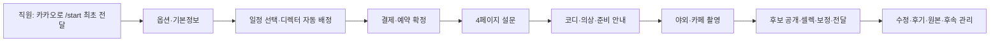

# 맨즈픽 OS 제품 요구사항 문서

제품의 목표 동작과 수용 기준을 설명한다. 기술 구조는 [Cloudflare 아키텍처](07-cloudflare-architecture.md)를 참고하고, 구현 여부는 코드와 테스트에서 확인한다.

2026-11-06에 Canonical v1.11, Figma 고객 화면 23개와 직원 화면, D3 API·권한 v0.2, D4 데이터 모델 v0.4를 바탕으로 구현 전에 작성했다.

## 1. 제품 정체성과 해결할 문제

맨즈픽은 남성의 스타일링과 프로필 사진 촬영을 제공하는 컨설팅 서비스다. 촬영은 야외·카페 등에서 iPhone으로 진행하며 스튜디오 대관형 서비스로 설계하지 않는다. 패키지에 따라 의상·코디·쇼핑·헤어 연계, 촬영, 셀렉, 보정, 후기와 원본 전달을 연결한다.

OS는 월 60명 이상의 고객을 대표 1명·디렉터 3명·내부 보정가 2명이 처리하는 업무를 연결한다. 고객이 다음 행동과 기한을 이해하고, 직원이 일정·준비·사진·요청·알림을 빠뜨리지 않는 것이 목적이다. 외부 판매용 SaaS가 아니라 맨즈픽의 실제 고객 여정을 관리하는 내부 운영 제품이다.

핵심 문제는 카카오 등으로 흩어진 정보·파일·진행 상태, 수동 안내와 확인 누락, 일정·담당 배정 경합, 고객 준비 지연, 셀렉·수정 요청의 추적 어려움이다. 기존 문의 횟수·누락률·처리 시간의 실측 기준선은 아직 없다. 이 문제 정의를 근거 없는 매출 증가 수치로 바꾸지 않는다.

## 2. 근거와 요구사항 상태

| 근거                                                                                                       | 사용 범위                                                                                                                                          |
| ---------------------------------------------------------------------------------------------------------- | -------------------------------------------------------------------------------------------------------------------------------------------------- |
| [F-C: Figma Customer UI](https://www.figma.com/design/cDXVLqZAaWwZeyIo5pqnNl/?node-id=56-2)                | 고객 23개 화면의 문구·입력·가격 표시·단계·모바일 행동                                                                                              |
| [F-D3: API·권한 v0.2](https://www.figma.com/design/cDXVLqZAaWwZeyIo5pqnNl/?node-id=172-2)                  | 인증·권한·서버 처리·예약·알림                                                                                                                      |
| [F-D4: DATA MODEL v0.4](https://www.figma.com/design/cDXVLqZAaWwZeyIo5pqnNl/)                              | D4 페이지의 32개 테이블·업무 무결성. 겉 레이어 v0.2와 본문 v0.4를 구분                                                                             |
| [F-I11: 최근 직원 후보 업로드 화면](https://www.figma.com/design/cDXVLqZAaWwZeyIo5pqnNl/?node-id=171-2339) | 모바일 후보 업로드·실패 재시도·셀렉 열기                                                                                                           |
| [N-CAN: Canonical v1.11](https://app.notion.com/p/Canonical-Manspick-OS-398af8f3d6b0817d9a84da6b2e770aca)  | 현재 업무·상태·전이·결제·기한·후기·범위의 기준                                                                                                     |
| [N-API: API v0.2](https://app.notion.com/p/API-v0-2-3eeaf8f3d6b081b6aadcd72a0017fd0c)                      | 고객 토큰·직원 인증·데이터와 파일의 경계                                                                                                           |
| [N-DEC: 의사결정 로그](https://app.notion.com/p/3628104e799d4f4db6ca20cc0e1e44fd)                          | 쇼핑 앞 슬롯·장소 공개 등 확정/폐기 결정                                                                                                           |
| Figma Website Desktop 14개 섹션·Legal 페이지                                                               | 랜딩 가격·납기·원본·수정·마케팅 수치·리드 폼과 최신 OS 정책의 충돌 확인. 카피 snapshot을 현재 판매 약속·실측 수치로 확정하지 않음                  |
| Product 1-Pager v0.2와 연결된 회의·운영 문서                                                               | 사업 목표·사용자·초기 범위. HOME 상위에서 확인한 회의록 12개는 2025년~2026년 1월의 역사적 운영 맥락이며 최신 Canonical의 제품 정책을 대체하지 않음 |
| 사용자 직접 조건                                                                                           | 3개 앱, Next.js 풀스택·TypeScript·Yarn workspaces·CSS 최적화·index.ts·ESLint·Prettier·단일 공용 design-system                                      |

**원문 정책**은 읽은 자료의 요구다. **설계 보완**은 구현의 안전성·사용성·검증을 위한 제안이며 원문에 있었다고 표현하지 않는다. **미결**은 서로 다른 출처 또는 빠진 세부 계약 때문에 구현 전 결론이 필요한 항목이다. 화면 구성은 Figma를 우선하고, 오래된 화면 설명과 최신 Canonical의 정책 충돌은 근거와 함께 기록한다.

각 고객 프레임의 실제 제목·노드·발견 경로는 [자료 대장](reference/00-sources-and-traceability.md)을 따른다. 이 PRD는 화면 23개를 임의로 23개의 독립 기능으로 바꾸지 않는다.

## 3. 출시 목표·포함·제외 범위

원문은 4주 구축 목표로 신규 고객 전체를 7단계로 운영하고 누락을 없애는 것을 지향한다. 고객·대표/직원·디렉터·보정가 역할을 동시에 제공한다. 4주는 일정 목표이며 실제 인력·검토·알림톡 업체 승인·운영 QA를 확인하기 전 확정 납기라고 보장하지 않는다.

| 출시 기준                  | 측정 정의                                                                |
| -------------------------- | ------------------------------------------------------------------------ |
| 신규 고객 100%를 OS에 등록 | 출시 후 신규 접수 고객을 분모로 하여 shoot 생성·접수 경로 집계           |
| 7단계 전 과정 기록         | 옵션부터 후속 관리까지 해당 촬영의 상태·담당·행동·결과 추적 가능         |
| 업무 누락 0건 목표         | 기한·입금·준비·셀렉·보정·후기·원본 전달의 미처리/오발송을 사건 단위 기록 |
| 4역할 실제 사용 가능       | 각 역할의 정상 업무와 거부 경로를 포함한 E2E·운영 QA 통과                |
| 고객 자료 비공개           | 타 촬영·퇴사자·미배정자 접근 거부와 private 파일 정책 검증               |

문의량, 제출 지연, 준비 누락, 수정 처리 시간, 첫 결과 열람과 알림 실패율은 기준선을 수집할 보조 지표다. 임의의 전환율·응답 시간·매출 목표를 추가하지 않는다.

초기 포함: 접수·상품/옵션·자동 배정 일정·수동 계좌 확인과 선결제 기록·설문·코디/준비·촬영·후보 공개·셀렉·보정/수정·후기/원본·알림톡·역할별 직원 OS·필수 설정.

초기 제외: PG 결제, 카카오 로그인, 네이티브 앱, AI 자동 보정, 외부 판매 SaaS, 외주 보정가 포털, 기존 진행 고객/과거 데이터 이관, 공개 웹사이트에서 OS로 이어지는 자동 유입 통합. landing 앱 폴더와 공개 안내 설계는 사용자 요구에 포함하되 초기 OS의 접수 시작은 직원이 카카오로 보내는 `/start` 링크다. 웹사이트 통합을 초기 운영의 필수 선행 조건으로 만들지 않는다.

## 4. 사용자·앱·주요 여정

| 사용자     | 앱      | 주요 업무                                                                    |
| ---------- | ------- | ---------------------------------------------------------------------------- |
| 방문자     | landing | 브랜드·서비스 이해. 공개 콘텐츠와 유입 통합의 상세 범위는 별도 확정          |
| 고객       | user    | 링크 접속, 옵션·기본정보·일정·결제·설문, 준비 확인, 셀렉·수정·후기·결과 열람 |
| 대표 admin | admin   | 전체 운영, 직원·권한·설정·가격·캠페인 관리                                   |
| staff      | admin   | 전체 촬영·입금·요청·배정·안내 등 운영. admin 설정 제외                       |
| director   | admin   | 배정 촬영·준비·코디·당일 업무, 본인 휴무                                     |
| retoucher  | admin   | 본인 보정 작업·선택 사진·보정 선호·사진별 의견. 고객 식별 정보 제외          |

고객은 회원 가입·이메일·OAuth 없이 `/s/{access_token}`와 전화번호 뒤 4자리로 한 촬영에 접근한다. 직원은 `@manspick.co.kr` 이메일 매직링크와 활성 staff 허용 목록을 사용한다. 상세 RBAC·세션·동의·악용 수용 기준은 [계정·권한](reference/02-accounts-and-permissions.md)을 따른다.

설문을 완료한 뒤에만 디렉터를 배정하는 옛 순서를 적용하지 않는다. 일정 단계에서 배정하고, 설문은 배정 디렉터가 제공 가능한 추가 옵션을 반영한다.

## 5. 7단계·30상태와 별도 취소

`shoots.status`가 단일 원장이고 stage는 여기서 파생한다. 아래 번호는 문서상의 순서이며 DB enum 값을 확정한 것이 아니다.

| 순서 | 단계      | 원문 상태                                                |
| ---- | --------- | -------------------------------------------------------- |
| 01   | 옵션 선택 | 신규 문의                                                |
| 02   | 옵션 선택 | 옵션 확인중                                              |
| 03   | 옵션 선택 | 옵션 선택 완료                                           |
| 04   | 일정 선택 | 캘린더 선택 대기                                         |
| 05   | 일정 선택 | 고객 일정 선택 완료                                      |
| 06   | 일정 선택 | 디렉터 자동 배정 완료                                    |
| 07   | 일정 선택 | 결제 확인 대기                                           |
| 08   | 일정 선택 | 촬영일 확정 안내 발송 완료                               |
| 09   | 설문      | 설문 작성 대기                                           |
| 10   | 설문      | 설문 제출 완료                                           |
| 11   | 촬영 준비 | 촬영 준비중                                              |
| 12   | 촬영 준비 | 전날 리마인드 발송 완료                                  |
| 13   | 촬영 준비 | 촬영 당일 대기                                           |
| 14   | 촬영      | 고객 도착                                                |
| 15   | 촬영      | 부가서비스 진행중 — 조건부                               |
| 16   | 촬영      | 의상 점검 완료                                           |
| 17   | 촬영      | 촬영중                                                   |
| 18   | 촬영      | 중간 확인 완료                                           |
| 19   | 촬영      | 촬영 완료 / 마무리 안내 완료 — 하나의 상태               |
| 20   | 결과물    | 셀렉 대기                                                |
| 21   | 결과물    | 셀렉 완료                                                |
| 22   | 결과물    | 보정 배정 완료                                           |
| 23   | 결과물    | 보정중                                                   |
| 24   | 결과물    | 전달 완료                                                |
| 25   | 후속      | 후기 요청 발송                                           |
| 26   | 후속      | 후기 확인 대기                                           |
| 27   | 후속      | 후기 확인 완료                                           |
| 28   | 후속      | 원본 전달 대기                                           |
| 29   | 후속      | 원본 전달 완료                                           |
| 30   | 후속      | 후속관리중                                               |
| 별도 | 취소      | 취소 — cancelled_at/reason 기록, 기본 운영 보드에서 숨김 |

기본은 순서대로 전이한다. admin/staff의 스킵·역행에는 사유가 필요하다. 시스템 예외는 선결제·hold 만료·D-1 미설문 세 가지다. 부가서비스가 없는 경우 조건부 상태의 정상 생략 경로를 상세 전이표에 명시한다. 알림 발송을 상태명으로 쓰는 경우 DB 예약만으로 실제 발송 완료 상태에 도달하지 않도록 성공 판정 계약이 필요하다.

## 6. 상품·옵션과 가격 스냅샷

다음 수치는 **현재 읽은 Figma 화면의 표시 스냅샷**이다. 공개 가격의 영구 정책·실제 할인 종료일로 단정하지 않으며 관리자 상품 설정과 예약 시 계약 스냅샷을 분리한다.

| 패키지     | 화면 정상가 → 표시가  | 촬영 시간  | 의상 | 기본 보정 |
| ---------- | --------------------- | ---------- | ---- | --------- |
| 원         | 135,000원 → 95,000원  | 90분       | 1벌  | 5장       |
| 하이브리드 | 210,000원 → 160,000원 | 2시간      | 2벌  | 7장       |
| 올데이     | 890,000원 → 500,000원 | 5시간 이상 | 4벌  | 12장      |

| 옵션       | Figma 표시 단가     | 처리                              |
| ---------- | ------------------- | --------------------------------- |
| 헤어       | 70,000원            | 촬영 전 제휴샵, 디렉터 미동행     |
| 의상 대여  | 25,000원            | 수량과 고객 의상 준비량에 반영    |
| 1코디 제작 | 50,000원            | 수량과 고객 의상 준비량에 반영    |
| 동행 쇼핑  | 100,000원           | 촬영 2시간 전 일정 자원 추가 확보 |
| 추가 보정  | 사진 1장당 10,000원 | 추가 결제 확인 후 작업            |

패키지 가격·보정 장수·벌수·소요 시간과 선택 옵션은 예약 당시 snapshot으로 보존한다. 관리자가 현재 상품을 바꿔도 과거 촬영 계약을 바꾸지 않는다. 옵션의 수량·중복 선택·상호 배타 조건과 최종 판매 가격은 구현 전 설정 계약으로 고정한다.

## 7. 기능 요구사항과 수용 기준

각 REQ는 출시 범위의 기능 묶음이다. AC는 구현 시 통과해야 할 수용 기준이며 지금 테스트가 실행됐다는 뜻이 아니다.

### REQ-001 — 최초 링크·접수·재방문

근거: F-C, N-CAN. 직원이 최초 `/start` 링크를 카카오로 한 번 전달하고 이후 안내는 알림톡으로 자동화한다.

- AC-001-01: 옵션 → 기본정보 → 일정 → 결제 → 설문의 순서를 제공한다. 이전 설문 선행 배정 흐름을 적용하지 않는다.
- AC-001-02: 같은 번호의 진행 중 촬영이 있으면 새 촬영을 중복 생성하지 않고 기존 개인 링크를 해당 번호로만 재발송한다. 요청 응답에서 고객 존재·개인 링크를 노출하지 않는다.
- AC-001-03: 진행 중 촬영이 없는 재방문 고객은 같은 customer 아래 새 shoot를 만든다. 이름·번호가 같은 별도 고객을 무분별하게 복제하지 않는다.
- AC-001-04 [설계 보완]: 중복 클릭·동시 접수·재전송에도 한 업무가 중복 생성되지 않고, 실패 후 입력을 보존한다.

### REQ-002 — 패키지·부가 옵션

근거: F-C, N-CAN, F-D4.

- AC-002-01: 패키지별 가격·시간·의상·보정 장수와 선택 옵션·총액을 명확히 표시한다.
- AC-002-02: 현재 가격은 관리자 설정에서 관리하고 예약 당시 가격·장수·벌수·시간은 촬영 snapshot으로 보존한다.
- AC-002-03: 대여·코디 제작 수량을 준비 의상 사진 필요량에 반영한다. 헤어를 선택해도 디렉터 촬영 시간을 제휴샵 동행 시간만큼 임의 차감하지 않는다.
- AC-002-04: 설문 추가 옵션은 배정 디렉터의 제공 가능 스킬을 반영하고, 다른 스킬의 상담은 카카오 경로로 안내한다.

### REQ-003 — 기본정보·결제 경로

근거: F-C, N-CAN.

- AC-003-01: 기본정보는 이름·전화번호·결제 경로·금액을 받는다. 지역·이메일·이미 받은 패키지를 중복 필수 질문으로 추가하지 않는다.
- AC-003-02: 선결제 채널은 크몽·프립·숨고·스마트스토어를 구분해 기록한다. 자체 PG 결제를 구현하지 않는다.
- AC-003-03: 기본정보의 금액·선택 상품·옵션·결제 기록이 직원 화면과 일치하고, 고객 입력만으로 금액 무결성을 신뢰하지 않는다.

### REQ-004 — 개인 링크 인증

근거: F-D3, N-API, N-CAN.

- AC-004-01: 가입·카카오 로그인 없이 촬영 토큰과 뒤 4자리 확인으로 해당 촬영에 접근한다.
- AC-004-02: 5회 실패·10분 잠금과 IP별 제한을 서버에서 적용한다. 인증 전에는 고객 이름·일정·사진을 공개하지 않는다.
- AC-004-03: httpOnly의 브라우저 종료 세션을 사용하고 토큰 재발급 시 이전 토큰을 무효화한다.
- AC-004-04 [설계 보완]: 다른 shoot_id·사진 경로·요청 ID를 주입해도 고객 세션 범위 밖의 데이터·서명 URL을 반환하지 않는다.

### REQ-005 — 일정·자동 배정·자원 잠금

근거: F-C, F-D3, F-D4, N-CAN.

- AC-005-01: 다음 날부터 8주 범위의 11·13·15·17시 슬롯을 기준으로 열린 디렉터 가능 시간의 합집합을 제공한다. 고객에게 디렉터를 먼저 고르게 하지 않는다.
- AC-005-02: 스킬·휴무·가능 시간·부하를 반영해 예약 시 디렉터를 자동 배정한다. 지역 질문을 배정 선행 조건으로 추가하지 않는다. 구체적인 동률 우선순위는 설정 계약으로 확정한다.
- AC-005-03: 하이브리드 2시간, 올데이 하루 4슬롯, 동행 쇼핑 촬영 2시간 전 자원을 함께 확보한다. 단순 화면 조회가 아니라 예약 DB 함수 안에서 경합을 재검사한다.
- AC-005-04: 올데이/일반/쇼핑 경합에서 일부 슬롯만 잡힌 예약이 생기지 않는다. 의사결정 로그에 따라 13시 촬영의 쇼핑은 11시 슬롯을 잠그고, 11시 촬영의 09시 쇼핑은 기본 슬롯이 없어 별도 슬롯 잠금이 필요하지 않다.
- AC-005-05: hold 해제 시 슬롯·디렉터 배정·미발송 알림을 함께 정리한다. 취소는 사유를 기록하고 담당자 보존 충돌은 아래 미결 항목을 따른다.

### REQ-006 — 결제·hold·추가 입금

근거: F-C, F-D3, F-D4, N-CAN.

- AC-006-01: 계좌이체 hold 만료는 `min(예약 시각 + 24시간, 촬영 시각 - 2시간)`이며 6·12·18시간 리마인드와 실제 만료의 관계를 검증한다. 만료 후 발송 예정 알림은 취소한다.
- AC-006-02: 계좌 입금은 직원이 확인하며 고객이 입금자명 확인 요청을 보낼 수 있다. 고객의 버튼 클릭만으로 확인 결제 상태를 만들지 않는다.
- AC-006-03: 원문의 선결제 즉시 확정 경로를 지원한다. 외부 채널 결제의 직원 확인 시점과 즉시 확정의 정확한 조건은 출처 충돌을 해소한 후 계약으로 고정한다.
- AC-006-04: 본결제·설문 추가·추가 보정을 구분하고 추가 옵션은 계좌 결제로 안내한다. 동일 입금 확인을 재실행해 금액·상태·알림이 중복 반영되지 않는다.
- AC-006-05: hold 만료와 입금 확인의 동시 실행을 원자적으로 처리한다. 촬영 취소를 실제 환불 성공으로 자동 표시하지 않는다.

### REQ-007 — 4페이지 설문·자동 저장

근거: F-C, N-CAN. 페이지별 필수 조건을 구분하며 네 페이지가 모두 완료됐을 때 제출 완료로 처리한다.

| 페이지 | 읽은 원문 내용                                                                                                                |
| ------ | ----------------------------------------------------------------------------------------------------------------------------- |
| 1      | 첫인사 평가 1~5, 나이, 직업 선택, 최근 얼굴 사진 1장 이상                                                                     |
| 2      | 스타일: 캐주얼/댄디/기타, 키·몸무게·상의·하의·신발, 체형 선택, 예산. 예산은 대여/1코디/동행 쇼핑 조건에서 필수이며 그 외 선택 |
| 3      | 신청 계기, 목적 복수 선택: 데이팅·카카오·SNS·추억·비즈니스, 보정 강도 0/25/50/75/100, 셀렉 주체 고객/디렉터, 고민 선택        |
| 4      | 배정 디렉터 스킬에 따른 추가 옵션, 외 스킬 카카오 문의, 유입 경로, 후기 혜택 참여, 선택 영상 포트폴리오 동의, 촬영 주의 확인  |

- AC-007-01: 입력·페이지 진행을 자동 저장하고 재진입 때 복구한다. 저장 중·실패·완료와 최종 제출을 구분한다.
- AC-007-02: 최근 얼굴 사진 필수·조건부 예산·페이지별 필수 조건을 검증한다. 현재 UI의 이미지 1장당 10MB 제한을 서버 파일 계약과 맞춘다.
- AC-007-03: 이름·번호·이메일·결제·패키지를 설문에서 중복 질문하지 않고 지역 질문을 제거한다. 유입 경로 5개 선택지의 정확한 문구는 Tally 원문 검증 전 임의 작성하지 않는다.
- AC-007-04: 설문 기본 마감 D-3, 의상 D-2를 표시한다. 이미 지난 근접 예약은 전날 20시, 그 시각도 지났으면 즉시 마감으로 계산한다.
- AC-007-05: 현재 C2-5의 제출 후 설문 편집은 D-3까지다. 근접 예약 예외와 제출 후 편집 종료의 정확한 결합은 미결로 기록한다.
- AC-007-06: 선택 포트폴리오/마케팅 동의 거절이 필수 서비스 이용을 막지 않으며 목적별 동의와 서비스 주의 확인을 분리한다.

### REQ-008 — 촬영 설계·9개 준비 안내

근거: F-C C4b, F-D4, N-CAN. 디렉터는 설문 미제출 상태에서도 촬영 설계를 진행할 수 있다.

C4b에서 확인한 9개 묶음의 의미는 촬영 확정, 촬영 설계(컨셉·의상 제안·참고 사진·동네), 준비물, 의상 사진 업로드, 부가서비스 안내, 커리큘럼, 장소·주차, 그루밍 노션, 변경·취소 규정이다. 이 목록은 의미 요약이며 최종 UI 라벨은 Figma 원문을 따른다.

- AC-008-01: 코디안은 concept·의상별 제안·참고 사진·고객 공개 note로 작성하고 공유 시 고객 화면과 알림을 연결한다.
- AC-008-02: 동네는 준비 중에도 정할 수 있다. 확정 미팅 장소·헤어 위치 지도와 공유 안내를 제공한다. 최초 기본정보에서 지역을 필수로 받지 않으며, 촬영 장소를 이틀 전까지 감추는 옛 정책을 적용하지 않는다.
- AC-008-03: 의상 사진 필요량은 `max(0, 패키지 벌수 - 대여 수량 - 1코디 제작 수량)`으로 계산하고 부족량·완료 상태를 표시한다.
- AC-008-04: 헤어는 촬영 전 제휴샵에서 진행하며 디렉터는 동행하지 않는다. 촬영 상품 시간을 헤어 시간만큼 임의 차감하지 않는다.
- AC-008-05: 고객이 준비 항목과 촬영 전날·당일 리마인드를 확인할 수 있고, 미확인·미업로드 항목을 직원이 추적한다.

### REQ-009 — 촬영 당일·셀렉 주체 확정

근거: F-C, F-D4, N-CAN.

- AC-009-01: 도착·조건부 부가서비스·의상 점검·촬영·중간 확인·촬영 완료/마무리 안내를 기록한다. 의상별 당일 진행을 추적한다.
- AC-009-02: 야외·카페 iPhone 촬영이라는 실제 서비스 동선을 반영하고 스튜디오 입장·장비 대여 절차를 임의 추가하지 않는다.
- AC-009-03: 셀렉 주체는 고객/디렉터이며 촬영 종료 시 확정한다. 설문 희망과 현장 확정 값을 구분하고 현장 변경에는 사유를 기록한다.
- AC-009-04: 종료·공유·배정 변경은 담당 범위·현재 상태를 검증하고 timeline을 남긴다.

### REQ-010 — 후보 업로드·셀렉 공개 게이트

근거: 최근 F-I11, F-D4, N-CAN.

- AC-010-01: 직원은 후보 약 40~50장을 모바일에서 일괄 업로드할 수 있다. 자동 축소·진행·성공/실패 항목을 구분한다. 정확한 후보 수를 임의의 필수 개수로 고정하지 않는다.
- AC-010-02: 실패 항목을 재시도하고 부분 성공 파일을 다시 중복 업로드하지 않는다. 최근 화면의 실패 2개 재시도 사례를 포함해 검증한다.
- AC-010-03: 후보 업로드 완료만으로 고객에게 공개하지 않는다. 별도 **셀렉 열기** 동작이 공개 게이트다.
- AC-010-04: 고객에게는 공개된 shortlist만 보인다. 셀렉 컷 업로드의 즉시 공개 동작과 후보 미공개→셀렉 열기를 같은 정책으로 합치지 않는다.

### REQ-011 — 셀렉·추가 보정 결제

근거: F-C, F-D4, N-CAN.

- AC-011-01: 패키지 기본 보정 장수·선택 수·추가 수량·추가 금액을 표시하고 제출 전 확인한다.
- AC-011-02: 기본 장수 초과분은 1장당 10,000원 계좌 결제를 안내하고 입금 확인 전 추가 작업을 시작하지 않는다.
- AC-011-03: 셀렉 주체에 맞는 입력 경로를 제공하고 기본/추가 round와 picks를 보관한다.
- AC-011-04: 셀렉 완료 시 실제 retouch_jobs를 생성한다. 예약 시 보정가 사전 배정과 작업 생성 시점을 구분한다.

### REQ-012 — 보정가 배정·보정·전달

근거: F-C, F-D4, N-CAN.

- AC-012-01: 예약 확정 때 요일 규칙으로 보정가를 사전 계산한다. 현재 기준 월·화 신민정, 수~일 최경선이며 admin이 규칙을 수정할 수 있다.
- AC-012-02: 보정가는 본인 작업의 선택 사진·보정 선호·사진별 의견만 읽는다. 이름·연락처·설문 전체·다른 보정가 작업은 노출하지 않는다.
- AC-012-03: 후보·보정·수정본은 private Supabase Storage에 두고 본인 촬영·공개 상태를 확인한 서명 URL로 제공한다.
- AC-012-04: 전달 완료·고객 열람·후속 행동을 구분한다. 파일 업로드 실패를 전달 완료로 표시하지 않는다. 최신 OS의 평균 1~3일 안내를 기준으로 삼되 보장 납기로 바꾸지 않는다. 구체 보정 기한/영업일 계산은 원문 계약을 추가 확정한다.

### REQ-013 — 수정 요청·사진별 의견

근거: F-C, F-D4, N-CAN.

- AC-013-01: 한 수정 요청에 여러 사진과 각 의견을 담는다. 사진 수와 관계없이 요청 한 건을 1회로 센다.
- AC-013-02: 전체 최대 3회 한도를 서버에서 검사한다. 동시 제출·재전송으로 네 번째 요청이 생성되지 않는다.
- AC-013-03: 요청 새요청/처리중/완료/반려와 담당·보정 결과를 추적한다. 반려·취소된 요청의 한도 집계는 미결 정책으로 확정한다.
- AC-013-04: 수정 사진과 요청 항목이 같은 shoot 소속인지 검증하고 작업·상태·타임라인·알림을 원자적으로 반영한다.

### REQ-014 — 후기·원본·추천 혜택

근거: F-C, F-D4, N-CAN. 캠페인 기준은 admin이 수정 가능하다.

- AC-014-01: 고객은 후기 캡처를 OS에 업로드하고 직원이 확인한다. 카카오에만 증빙을 보내야 완료되는 흐름으로 되돌리지 않는다.
- AC-014-02: 후기 승인 시 준비된 R2 원본 또는 외부 원본 링크를 해당 고객에게 공개한다. 지정된 후기 캠페인이 활성일 때 `campaign_claims`에 혜택 접수를 기록한다.
- AC-014-03: 후기 승인·원본 공개·알림 기록과 해당하는 혜택 접수를 하나의 트랜잭션에서 처리한다. 재처리로 혜택이 중복 생성되지 않는다.
- AC-014-04: 추천은 이름을 카카오로 확인하며 추천인·피추천인 양쪽 5,000원 기준을 캠페인으로 관리한다. 자동 지급이나 포인트 지갑을 임의 구현하지 않는다.
- AC-014-05: 최신 블로그 후기 조건은 사진 2장이다. 옛 내부 화면의 1장 조건을 적용하지 않는다. 금액·조건·유효 기간은 현재 캠페인 설정과 연결한다.
- AC-014-06: 고객 원본 공개는 광고·포트폴리오 외부 게시 동의로 간주하지 않는다.

### REQ-015 — 직원 OS·권한·수동 예외

근거: F-D3, F-D4, N-CAN, N-API.

- AC-015-01: admin/staff는 전체 운영, director는 배정 촬영/본인 휴무, retoucher는 본인 작업의 마스킹 정보만 제공한다.
- AC-015-02: 고객별 단계·담당·기한·결제·요청·알림·메모·타임라인을 연결해 누락을 찾을 수 있다. 내부 메모를 고객 API에 포함하지 않는다.
- AC-015-03: 상태는 순서대로 변경한다. admin/staff의 스킵·역행·취소·배정 덮어쓰기는 사유를 요구하고 전후 값·행위자를 기록한다.
- AC-015-04: 취소 촬영은 기본 운영 보드에서 숨기되 결제·요청·이력을 물리 삭제하지 않는다. active=false 직원과 배정 해제자는 이후 조회·변경·파일 발급을 할 수 없다.

### REQ-016 — 알림톡·예약 작업·수동 큐

근거: F-D3, F-D4, N-CAN.

- AC-016-01: 알림톡 연동은 출시 필수이며 업체는 미정이다. 업체 선정 전에는 수동 발송 큐와 처리 확인을 제공하되 최종 자동 연동 요구를 삭제하지 않는다.
- AC-016-02: 최초 링크만 직원이 복사해 보내고 이후 예약·기한·설문·준비·셀렉·전달·후기·원본 안내를 조건별로 자동화한다.
- AC-016-03: 원문 주기는 10분 hold 정리, 1분 알림 처리, 00:10의 8주 앞 슬롯 생성, 09시 마감 리마인드, 촬영 전날 20시/당일 00시 자동 상태 처리다.
- AC-016-04: 알림 대기/발송/실패/취소·실제 처리자·provider_msg_id를 기록하고 취소/hold 만료의 미발송 알림을 취소한다.
- AC-016-05 [설계 보완]: cron 중복·지연·업체 장애에도 중복 발송을 막고 미처리 알림을 재시도한다. 수동 발송 완료와 자동 예약만 된 상태를 구분한다.

### REQ-017 — 관리자 설정

근거: F-D4, N-CAN, 사용자 기술 조건.

- AC-017-01: admin이 직원 role·active, 디렉터 스킬·휴무, 보정가 요일 규칙, 패키지·옵션·캠페인·알림 기준을 관리한다.
- AC-017-02: staff/director/retoucher가 설정 API를 직접 호출해 가격·역할·캠페인 기준을 변경할 수 없다.
- AC-017-03: 설정 변경이 기존 촬영 snapshot·이미 확정된 배정·발송 예약에 미치는 적용 시점을 명시하고 변경 이력을 남긴다.
- AC-017-04: 같은 고객/설정 데이터를 세 앱에서 각각 복제 관리하지 않고 공통 서버·DB 계약을 사용한다.

### REQ-018 — 사용성·보안·운영 품질

아래는 원문 기능을 제품으로 검증하기 위한 설계 보완이다.

- AC-018-01: 고객의 핵심 흐름과 직원 모바일 업로드가 작은 화면·터치·키보드 환경에서 완료된다. 입력 라벨·오류 연결·보이는 포커스·비색상 상태 표현을 제공한다.
- AC-018-02: 저장·업로드·결제 확인·알림 실패를 해당 동작 근처에 표시하고 재시도 시 중복 업무가 생기지 않는다.
- AC-018-03: 다른 고객·미배정 직원·퇴사자·보정가의 민감 데이터 접근을 서버/DB/파일 수준에서 거부한다. 개인화 캐시·로그에 토큰·사진·설문 전문이 섞이지 않는다.
- AC-018-04: 공개 사진 마케팅 동의와 필수 서비스 동의를 분리한다. 고객 업로드의 삭제 요청을 처리하되 정확한 보존 기간·삭제 예외는 미결 정책으로 남긴다.
- AC-018-05: 3앱 production 빌드, lint·typecheck·format, 핵심 상태/인가/동시성·파일·알림 통합 검증을 통과한다. 현재 문서 단계에서 실행됐다고 표기하지 않는다.

### REQ-019 — 공개 안내·약관·개인정보 정합성

근거: Figma Website Desktop 14개 섹션·Legal, N-CAN, N-DEC와 구형 추천 자료. 이 항목은 법적 유효성 판단이 아니라 서비스 계약 문구와 실제 제품 동작을 일치시키기 위한 출시 기준이다. 별도 랜딩 원문이 존재한다는 이유로 오래된 약속을 계속 유효한 제품 정책으로 확정하지 않는다.

- AC-019-01: Figma 약관의 무제한 보정 수정·불만족 시 1회 무료 재촬영 문구와 최신 OS의 수정 3회 규칙을 대조하고 공개 약관을 정리한다. 무제한 수정·무료 재촬영을 새 기능으로 자동 확정하지 않는다.
- AC-019-02: Figma 개인정보의 수집 후 1년 보유 문구와 OS의 삭제 요청 전 보관 방향을 함께 검토해 보존 정책을 확정한다. 상담 폼의 성함·전화번호·마케팅 가이드북 발송 목적은 OS 필수 서비스 동의와 구분한다.
- AC-019-03: Figma 기재 환불 기준인 D-3 전액, D-2~전날 50%, 당일·노쇼 0%, 무료 일정 변경 1회는 최신 변경·취소 카카오 수동 운영과 정합성을 확인한다. OS에 환불 자동 계산·자동 송금을 추가하지 않는다.
- AC-019-04: 랜딩의 ONE 120,000원→85,000원과 최신 OS의 135,000원→95,000원을 구분한다. 최신 OS 패키지 snapshot을 우선해 공개 가격을 정리하고 구형 AI·DSLR·강의 옵션을 현재 패키지와 혼합하지 않는다. 가격·수정·재촬영·보존·취소 문구의 운영 결정을 출시 전 확인한다.
- AC-019-05: 랜딩의 촬영 당일 보정 완료와 최신 OS의 평균 1~3일, 원본 300+/500+/700+ 전량 즉시 전달과 최신 OS의 후기 확인 후 전체 원본 공개가 충돌함을 표시한다. 초기 OS는 평균 1~3일·수정 최대 3회·후기 확인 후 원본 공개를 우선 적용하고, 당일 완료·즉시 원본 수량을 새 보장 기능으로 추가하지 않는다.
- AC-019-06: 랜딩의 1,127+·46K·4.97, 동적 잔여석·상담사 대기·응답 시간 표시는 Figma 카피 snapshot으로 기록한다. 출시 전 수치의 의미·근거·갱신 시점과 실제 데이터 연동 여부를 검증하고 확인되지 않는 표시는 수정·제거한다. 리드 폼·가이드북 발송의 목적·동의·운영 경로도 확정한다.

## 8. 데이터·기술 요구

촬영 중심 32개 테이블·관계·불변 조건은 [데이터·흐름](archive/05-data-and-flows.md), 인증·권한·개인정보는 [계정·권한](reference/02-accounts-and-permissions.md)이 상세 계약이다. 고객의 DB 직접 접근은 없고 Next.js 서버가 session.shoot_id로 제한한다. 내부 읽기는 Supabase RLS, 중요 변경은 서버 검증 후 트랜잭션 함수로 통일하는 설계 보완을 사용한다.

사용자 고정 기술은 Next.js 풀스택·TypeScript·최적화 CSS·공개 index.ts·ESLint·Prettier·Yarn workspaces다. apps/admin·user·landing을 분리하고 공통 컴포넌트·토큰·아이콘·애셋은 단일 packages/design-system에서 공유한다. 원문 인프라는 Supabase Postgres/Auth/RLS/Storage와 Vercel이며, 현재 구현은 Cloudflare를 사용한다. [Cloudflare 아키텍처](07-cloudflare-architecture.md) · [디자인 시스템](reference/03-design-system.md)

## 9. 충돌·폐기·미결

| 항목                                                | 현재 정리·남은 결정                                                                                                                              |
| --------------------------------------------------- | ------------------------------------------------------------------------------------------------------------------------------------------------ |
| 구형 User Flow/1-Pager v0.1                         | 명시적으로 폐기. 최신 접수 순서와 end-to-end 범위 적용                                                                                           |
| 1-Pager v0.2의 알림톡 자동 발송 제외·사진 설문만 OS | 최신 Canonical v1.11/D3가 대체. 알림톡 필수·7단계 전체 운영으로 설계                                                                             |
| 옛 설문 후 배정                                     | 일정에서 디렉터 자동 배정 후 결제·설문으로 대체                                                                                                  |
| 옛 내부 수동 알림 전용 문구                         | 최신 자동화 요구로 대체. 업체 선정 전 수동 큐는 임시 운영 수단                                                                                   |
| 옛 내부 블로그 후기 사진 1장                        | 최신 Canonical의 2장 적용                                                                                                                        |
| 취소 시 director_id                                 | Notion ERD v0.4는 기록용 유지, Canonical은 디렉터 해제로 충돌. 제안: 현재 배정·슬롯 해제, 이전 담당은 timeline 보존. 결정 전 확정하지 않음       |
| 선결제 즉시 확정                                    | 고객의 외부 채널 신고만으로 확정인지 직원 확인 후 확정인지 원문 표현 차이 해소 필요                                                              |
| 11시 촬영+쇼핑                                      | 미결 해소. 의사결정 로그는 09시 기본 슬롯이 없어 잠금 불필요라고 명시. 13시 촬영은 11시 슬롯 잠금                                                |
| 장소 공개                                           | 촬영 이틀 전 공개 정책은 폐기. 확정·공유된 장소를 준비 흐름에서 안내                                                                             |
| Figma 약관의 수정·재촬영                            | 무제한 수정/1회 무료 재촬영과 최신 OS 수정 3회가 충돌. 신규 기능 확정 없이 공개 약관 정합성 검토·개정 필요                                       |
| 개인정보 보존                                       | Figma의 1년과 OS의 삭제 요청 전 보관 방향이 충돌. 실제 적용 기간·목적·삭제 범위 결정 필요                                                        |
| 변경·취소                                           | Figma의 D-3 전액/D-2~전날 50%/당일·노쇼 0%, 무료 변경 1회와 최신 카카오 수동 운영을 정리. 자동 계산 제외                                         |
| 랜딩 가격·구형 추천                                 | 랜딩 ONE 120,000원→85,000원과 최신 OS 135,000원→95,000원이 충돌. 최신 패키지를 우선하며 AI·DSLR·강의 옵션 등 구형 문구를 현재 상품에 합치지 않음 |
| 랜딩 보정 속도·원본                                 | 촬영 당일 보정/원본 300+·500+·700+ 전량 즉시 안내와 최신 OS 평균 1~3일/후기 확인 후 전체 원본 공개가 충돌. 최신 OS를 우선하고 공개 카피 수정     |
| 랜딩 마케팅 수치·리드 접수                          | 1,127+·46K·4.97·잔여석·상담사 대기·응답 시간은 실측·실시간 근거 미검증. 근거·갱신·데이터 연동 및 리드 폼/가이드북 목적·동의를 출시 전 확인       |
| 근접 마감·설문 편집                                 | D-3 편집 종료와 전날20시/즉시 마감 예외의 결합 확정 필요                                                                                         |
| 세부 입력·검증                                      | 유입 경로 5개 실제 값, 수량 상한·상호 배타 옵션, 파일 형식·용량·사진 후보 수 검증 확정                                                           |
| 완료·거절·정정                                      | 반려/철회 수정 요청의 3회 집계, 환불/오입금/정정, 담당 변경·일정 변경 조건 확정                                                                  |
| 후속 운영                                           | 캠페인 현금 처리 절차·기간, 알림톡 업체/템플릿 승인, 보정 기한, 자료 보존·삭제 범위 확정                                                         |

미결은 임의 값으로 채운 기능을 먼저 구현하라는 뜻이 아니다. 각 항목의 출처·결정자·결정·영향 요구사항을 [결정·구현 순서](archive/06-decisions-and-delivery.md)에 남긴다.

## 10. 완료 판정

문서 검토 완료는 출처·기능·상태·권한·미결이 서로 연결되고, 선택한 정책이 Figma 흐름과 맞는 시점이다. 구현 완료는 모든 포함 REQ의 AC를 검증하고 4역할이 실제로 신규 고객의 7단계를 운영할 수 있는 시점이다. 공개 약관·개인정보·상품 안내와 OS 동작의 충돌을 결정·개정하고 확인하는 절차는 출시 전 필수 조건이다. 화면만 만들어졌거나 알림을 DB에 예약한 상태를 실제 운영 완료로 표시하지 않는다.
