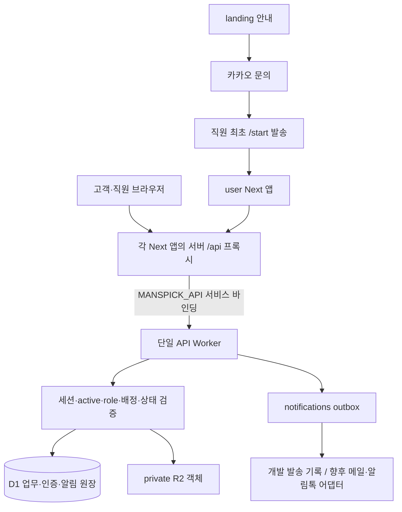

# Cloudflare 전환 아키텍처와 로컬 실행 기준

작성일 2026-11-06. 프런트엔드 배포 구성 갱신일 2026-11-10. 최신 사용자 요청: Cloudflare Workers + D1 + R2, Next.js 3앱·Yarn workspace·단일 design-system 유지, 로컬 구현·검증만 진행하고 배포하지 않는다.

## 1. 적용 우선순위와 변경 범위

이 문서는 현재 Cloudflare 구현의 기술 구조를 설명한다. API 동작과 환경 설정은 [서버 README](../apps/server/README.md), 운영 전 확인은 [운영 인수인계](reference/10-client-admin-architecture.md#현재-맨즈픽-운영-인수인계)를 참고한다. Supabase·Vercel을 사용한 원문 설계의 판단은 [보관 기록](README.md#보관-기록)에 남아 있다.

| 구분             | 이번 결정                                                                                                     |
| ---------------- | ------------------------------------------------------------------------------------------------------------- |
| 사용자 고정      | Next.js 풀스택·TypeScript·Yarn workspaces, apps/admin·user·landing, CSS 최적화·공개 index.ts·ESLint·Prettier  |
| 사용자 고정      | packages/design-system 한 곳에 토큰·공통 컴포넌트·아이콘·애셋                                                 |
| 최신 인프라 선택 | Cloudflare Workers·D1·R2. Supabase Auth/RLS/Storage/Postgres와 Vercel을 구현 의존에서 제거                    |
| 구현 구조 결정   | apps/server/src/worker.ts의 단일 서버 Worker가 인증·인가·업무 변경·D1·R2를 소유. 세 Next 앱은 서버에서 프록시 |
| 로컬 실행        | API Worker 127.0.0.1:8787, Next 앱은 독립 포트. 로컬 리소스만 사용                                            |
| 운영 목표 구조   | 앱별 Vinext Worker → 내부 서비스 바인딩 → API Worker                                                          |
| 업무 유지        | 개인 링크·뒤4자리, 직원 4role, 30상태+별도 취소, 후기 확인 후 원본 공개, 수정3회 등 현행 정책                 |
| 파일 저장        | 고객 파일은 private R2에 저장. 원본 전달은 R2 원본 또는 검증한 외부 HTTPS 링크를 지원                         |

API Worker는 별도 Next.js 앱을 추가하는 것이 아니라 공통 서버의 실행 진입점이다. 제품 화면 폴더는 사용자 요청대로 세 개다. 서버 업무를 세 앱에 중복 구현하거나 브라우저가 D1을 직접 조회하는 구조를 만들지 않는다.

현재 API의 HTTP 계층은 `hono@4.13.16`이다. `http/app.ts`가 공통 Origin 검사와 기능별 라우터를 조립하고, 공개 경로 뒤에 인증 미들웨어를 배치해 보호 요청의 검증된 actor를 전달한다. 알림·설정에는 역할 미들웨어를 추가하며 촬영·파일 소유권과 D1/R2 변경은 기존 업무 모듈이 책임진다. Hono context는 HTTP 계층에서 사용한다. 경로·응답 계약과 검사는 [서버 README](../apps/server/README.md)를 따른다. Hono는 Workers의 Fetch API와 binding을 직접 사용한다. [Hono Workers 안내](https://hono.dev/docs/getting-started/cloudflare-workers)

## 2. 프런트엔드 빌드와 배포

세 앱은 Next.js App Router의 경로와 `next/*` API를 Vinext에서 실행한다. Vite와 Cloudflare Vite 플러그인이 프런트엔드를 Worker용으로 빌드하고 `cf`가 배포한다. 버전은 앱별 `package.json`과 `yarn.lock`에 고정한다. API와 Storybook의 Wrangler 설정은 `infra/`에 있다. [Vinext Workers 안내](https://vinext.dev/docs/deploying/cloudflare)

`cloudflare.config.ts`에 앱별 Worker 이름과 `MANSPICK_API` 서비스 바인딩을 선언한다. 관리자 `test` 모드는 비공개 테스트 API Worker를 가리킨다. 공유 캐시나 이미지 최적화용 Cloudflare 리소스는 구성하지 않는다. [Cloudflare 테스트 환경](../README.md#cloudflare-테스트-환경)

## 3. 로컬 검증

`yarn dev`는 Wrangler API Worker와 세 Vinext 앱을 실행한다. 화면 앱의 서버 코드도 로컬 `workerd`에서 동작하며, 프록시는 `MANSPICK_API` 바인딩을 통해 API에 연결한다. `yarn build`는 세 프런트엔드의 Workers 산출물과 API 번들을 생성한다. 앱의 `preview`는 빌드한 Worker를 로컬에서 실행한다.

`yarn test:local`은 세 화면의 API 연결과 공통 API의 세션·권한·파일 전송을 점검한다. 운영 도메인, 리소스, 배포 상태는 별도로 검증한다.

## 4. 단일 API Worker와 신뢰 경계

운영 목표는 API Worker에 공개 workers.dev/custom route를 주지 않고 Next Worker의 Service Binding으로 호출하는 것이다. HTTP Service Binding은 다른 Worker의 fetch handler를 내부적으로 호출할 수 있다. 이것은 향후 운영 설정이며 배포된 상태로 표현하지 않는다. [Service Binding HTTP](https://developers.cloudflare.com/workers/runtime-apis/bindings/service-bindings/http/)

프록시는 브라우저가 보낸 role·staff_id·shoot_id를 신뢰된 실행 문맥으로 승격시키지 않는다. API Worker가 세션을 직접 검증하고 현재 DB의 active·배정과 자원 소속을 확인한다. 내부 통신이라는 사실이 사용자 인가를 대체하지 않는다. 전달할 Cookie·Origin·요청 ID의 허용 목록을 정하고 헤더 변조를 검사한다. 파일 응답의 Set-Cookie·Cache-Control·Content-Type·스트림도 손상 없이 전달한다.

로컬 8787은 loopback에 바인딩하고 인증을 생략하지 않는다. 포트 차이는 쿠키의 보안 경계가 아니므로 고객/직원 쿠키 이름·서명 문맥·audience를 분리한다. CSRF·Origin 검증은 개발 허용 origin 목록과 향후 운영 호스트 목록을 구분한다. 미인증 개발 관리자 우회 경로를 일반 API로 제공하지 않는다.

## 5. D1·R2 로컬 상태의 단일 소유

Wrangler의 로컬 실행은 Miniflare/workerd로 binding을 제공한다. 기본은 로컬 리소스지만 remote binding을 선택할 수도 있으므로 이 프로젝트에서는 remote 연결을 사용하지 않는다. 로컬 workerd의 시간대는 UTC이며 PC의 시간대와 무관하다. [Workers 로컬 실행](https://developers.cloudflare.com/workers/local-development/)

하나의 API Worker 프로세스가 같은 D1 DB와 R2 bucket binding을 소유한다. 각 Next 앱이 별도 Miniflare 인스턴스를 생성해 같은 SQLite 파일에 쓰지 않는다. persist 위치는 저장소 아래 한 곳으로 정하고 재시작·마이그레이션·테스트 초기화를 이 소유 프로세스의 명령으로 통일한다. 테스트 DB와 개발 DB는 다른 경로를 사용하며 검증을 위해 개발 상태를 무단 삭제하지 않는다.

공식 D1 로컬 도구는 --local을 사용하고 persist-to로 경로를 지정할 수 있다. 로컬 명령에 --local이 없거나 remote binding이 설정된 상태를 같은 의미로 취급하지 않는다. [D1 로컬 개발](https://developers.cloudflare.com/d1/best-practices/local-development/)

### Node Next 서버에서 binding을 직접 얻는 대안의 평가

getPlatformProxy는 Node 프로세스에서 로컬 workerd의 D1/R2/Service binding proxy를 제공한다. Workers 내부에서 실행하는 API가 아니며 실제 production과 차이가 있는 최선의 에뮬레이션이다. persist.path는 Wrangler persist-to 경로와 달리 v3를 자동 추가하지 않아 같은 상태를 공유할 때 경로를 맞춰야 한다. **이 기능이 가능하다는 것과 세 Next 프로세스가 각각 같은 파일을 동시에 소유해도 된다는 판단은 다르다.** 이번 구조는 API Worker 한 곳으로 소유권을 모은다. [Wrangler getPlatformProxy](https://developers.cloudflare.com/workers/wrangler/api/)

Miniflare 자체도 Node에서 getD1Database·getR2Bucket을 제공하고 한 인스턴스 안에 여러 Worker를 넣을 수 있다. 테스트 fixture·통합 검증에 사용할 수 있지만, Next 서버마다 별도 로컬 DB를 만들거나 운영에서 Miniflare를 실행하는 방식은 채택하지 않는다. [Miniflare D1](https://developers.cloudflare.com/workers/testing/miniflare/storage/d1/), [Miniflare R2](https://developers.cloudflare.com/workers/testing/miniflare/storage/r2/), [여러 Worker](https://developers.cloudflare.com/workers/testing/miniflare/core/multiple-workers/)

향후 세 Next 산출물과 API Worker를 함께 preview할 때도 Service Binding과 동일 리소스 식별자를 확인한다. Wrangler의 별도 dev 명령끼리 Service Binding 통신이 가능하지만, 로컬 preview 동작·버전·프로세스 종료를 실제로 확인해야 한다. [다중 Worker 로컬 개발](https://developers.cloudflare.com/workers/local-development/multi-workers/)

## 6. Postgres/RLS에서 D1으로 바뀌는 계약

| 기존 기술 설계                    | Cloudflare 전환                                                                   |
| --------------------------------- | --------------------------------------------------------------------------------- |
| Supabase Auth                     | API Worker의 고객·직원 인증 서비스와 서버 세션. 메일 발송은 별도 어댑터           |
| 직원 브라우저 Supabase 조회+RLS   | 브라우저 DB 접근 없음. API Worker의 역할·배정 SQL 조건과 허용 DTO                 |
| 서비스키 기반 고객 DAL            | D1 binding은 API Worker만 소유. 검증된 세션 shoot_id 필터를 모든 자원 접근에 적용 |
| Postgres 트랜잭션 함수 9개        | 같은 이름·책임의 서버 유스케이스 + 조건부 SQL·D1 batch·DB 제약                    |
| Postgres UUID/JSONB/enum/행 잠금  | SQLite 호환 ID·JSON/검증·상태 제약·경합 처리로 명시적 재설계                      |
| Supabase Storage 3 private bucket | R2의 private 객체 분류. 원본도 R2에 추가                                          |
| Supabase Cron                     | API Worker의 scheduled handler와 지속 가능한 notifications 원장                   |

원문의 32개 업무 테이블은 논리 설계의 출발점이다. D1에는 인증 세션·일회용 로그인 토큰·멱등 요청 등 인프라 저장소가 추가될 수 있다. 따라서 최종 물리 테이블 수를 억지로 32개로 맞추지 않으며 새 테이블을 원문 요구로 속이지 않는다. 1차 구현의 테이블이 32개보다 적으면 미구현 업무를 명시한다. D1 DB에는 사진 바이너리를 저장하지 않고 R2 객체 키·MIME·크기·공개 상태 등 메타데이터만 둔다.

고객은 세션 shoot_id 범위, director는 현재 배정된 촬영 범위, retoucher는 본인 job과 선택 사진·보정 선호·사진별 의견만 조회한다. 이름·번호·설문 전체를 포함한 후 클라이언트에서 감추지 않는다. SQL parameter binding·공통 인가 함수·허용 필드 projection을 적용하고 목록·건수·파일에도 같은 조건을 사용한다.

## 7. 예약과 중요 변경의 원자성

D1의 batch는 준비한 SQL들을 순서대로 실행하는 트랜잭션이며 중간 statement 오류가 나면 전체 sequence를 중단/롤백한다. 일반 개별 쿼리는 auto-commit이므로 서버에서 조회 후 여러 await update를 실행하는 것으로 한 업무의 원자성을 주장하지 않는다. 이 API는 JavaScript 분기와 외부 I/O를 끼워 넣는 임의 Postgres 트랜잭션의 대체가 아니다. [D1 batch](https://developers.cloudflare.com/d1/worker-api/d1-database/)

**UPDATE가 0행을 변경한 것은 SQL 오류가 아니다.** batch 이후 changes를 검사해 예외를 던져도 이미 커밋된 다른 statement를 되돌리지 못한다. 예약 조건 실패를 batch 안의 제약 오류로 만들거나, 모든 연관 변경을 동일한 성공 조건에 종속시키고 기대 행 수를 검증하는 설계가 필요하다. UNIQUE/CHECK/FK, 필요한 경우 trigger의 RAISE(ABORT), 요청 식별자를 조합하는 안을 검토한다. 단순 INSERT OR IGNORE로 경합을 숨긴 채 결제·알림을 계속 생성하지 않는다. SQLite의 RAISE(ABORT)는 constraint 오류를 반환한다. [SQLite trigger·RAISE](https://www.sqlite.org/lang_createtrigger.html)

book_slot의 최소 불변 조건은 다음과 같다.

1. 검증된 고객 촬영·현재 상태·상품·기한을 기준으로 가능한 디렉터를 재검증한다.
2. 일반 슬롯, 올데이 4개, 쇼핑의 존재하는 앞 슬롯을 같은 변경 단위로 확보한다.
3. 디렉터·슬롯·촬영·결제 hold·timeline·notifications가 함께 성공하거나 함께 실패한다.
4. hold는 min(예약+24시간, 촬영−2시간). 13시 쇼핑은 11시 잠금, 11시 촬영의 09시 쇼핑은 잠금 불필요다.
5. 경합 loser·응답 유실 후 재요청·같은 idempotency key에 대해 중복 촬영/결제/알림이 생기지 않는다.

D1 DB는 단일 DB 단위로 쿼리를 한 번에 하나씩 처리하지만, 여러 네트워크 요청으로 나눈 조회/변경이 하나의 업무가 되는 것은 아니다. 현재 규모에서 D1 하나를 권고하며, 트래픽 한계는 실제 쿼리·인덱스·동시성으로 측정한다. Postgres SELECT FOR UPDATE나 메모리 mutex를 Workers 전역 잠금으로 가정하지 않는다. [D1 FAQ](https://developers.cloudflare.com/d1/reference/faq/)

confirm_payment/release_hold 경합, 수정3회 제한, 후기 완료→claim+원본 해제도 같은 방식으로 검증한다. 취소 시 director_id 보존/해제의 원문 충돌은 기술 전환으로 해결되지 않는다. 확정 정책 전에는 현재 배정 해제+timeline 과거 담당 보존을 권고안으로만 둔다.

## 8. 인증·메일·로컬 대역

고객의 토큰+뒤4자리, 5회 실패/10분 잠금+IP 보완, 브라우저 종료 httpOnly 세션과 토큰 재발급 무효화는 유지한다. 직원은 @manspick.co.kr 활성 허용 목록+admin/staff/director/retoucher다. Supabase Auth를 제거해도 매직링크의 일회성·만료·재사용 방지·세션 폐기·callback 허용 목록·발송 제한을 구현해야 한다.

설계 보완으로 로그인 토큰과 세션 식별자는 난수로 만들고 DB에는 해시를 저장한다. 토큰 소비와 세션 생성은 원자적으로 처리한다. 직원 active·role·배정은 매번 현재 DB로 재검증한다. 토큰 TTL·직원 세션 기간·재인증은 운영 결정을 기록하고 고객 세션을 장기 자동 로그인으로 바꾸지 않는다.

현재 Cloudflare에는 Email Sending Beta가 있으며 임의 수신자 발송에는 Workers Paid가 필요하다. 검증된 계정 목적지로의 발송과 임의 직원 수신자 발송은 조건이 다르다. Email Routing은 인증 세션 제공 서비스가 아니므로 이 기능만 켜면 Supabase Auth가 대체된다고 해석하지 않는다. 도메인·발신 인증·계정 사용 가능 여부·실제 도달 검증이 별도 필요하다. [Cloudflare Email Service](https://developers.cloudflare.com/email-service/), [검증 목적지와 라우팅](https://developers.cloudflare.com/email-service/configuration/email-routing-addresses/)

이번 로컬에서는 발송 어댑터를 개발용 outbox로 대체할 수 있다. 링크 확인 경로는 명시적 development-only·loopback·테스트 계정 범위로 제한하고 일반 고객/공개 응답에서 링크나 토큰을 반환하지 않는다. 이는 메일 발송·인증 보안의 운영 검증 완료가 아니다. 실제 발송은 이번에 실행하지 않는다.

## 9. private R2와 원본 공개

R2에는 설문/의상/후기, 후보/보정/수정, 코디 참조, 원본을 저장한다. 분류별 prefix 또는 bucket 분리는 운영 정책으로 고정하되 모든 고객 자료를 private으로 둔다. 디자인 시스템 assets에는 공개 브랜드 자산만 포함한다. R2 binding으로 객체를 읽고 쓰는 공식 Worker API를 사용한다. [R2 Workers API](https://developers.cloudflare.com/r2/api/workers/workers-api-usage/)

1차는 **브라우저→Next 서버 미디어 경로→API Worker 인가→R2 stream**을 기본안으로 둔다. 파일 ID에서 D1의 shoot·공개 상태·작업 배정을 확인하고 객체 키를 결정한다. 임의 key/path를 서명하거나 반환하지 않는다. Range·Content-Type·크기 제한·오류·부분 업로드·객체 정리도 파일 계약으로 검증한다.

R2의 S3 presigned URL은 별도 자격 증명이 필요하고 S3 API 도메인에서 동작한다. Worker binding이 자동으로 Supabase식 signed URL을 만들어 주는 것으로 가정하지 않는다. 로컬 Miniflare R2를 사용하면서 실제 계정의 S3 URL에 업로드하지 않는다. 향후 presigned 도입 시 짧은 만료·인가·CORS·URL 유출·철회 한계를 검증한다. [R2 presigned URL](https://developers.cloudflare.com/r2/api/s3/presigned-urls/)

후보는 셀렉을 열 때 공개한다. 원본은 private R2 객체 또는 검증한 외부 HTTPS 링크로 준비할 수 있으며, 고객에게는 후기 승인 후 공개한다. 세부 저장 규칙은 [서버 README](../apps/server/README.md)를 따른다.

기존 고객 데이터 이관은 전환 범위에서 제외한다. 향후 이관 시 기존 외부 링크 보존과 R2 메타데이터 변환 방식을 이관 계약에 명시한다.

## 10. Cron·Queues·outbox

notifications를 D1의 지속 가능한 outbox로 둔다. 업무 변경과 outbox 생성은 같은 batch에 넣고, 실제 외부 발송/Queue 전송은 커밋 후 수행한다. D1과 Queue 전송, D1과 R2 객체 저장은 하나의 분산 트랜잭션이 아니다. 발송 전후 프로세스 종료·재시도를 복구하는 상태와 idempotency key가 필요하다.

초기는 같은 API Worker의 scheduled 처리와 명시적 로컬 작업 실행으로 충분하다. 향후 Cloudflare Queues는 발송 부하 분리·재시도에 선택할 수 있다. Queues는 at-least-once여서 중복 전달이 가능하며 DB/공급자 멱등 키로 중복 발송을 막아야 한다. Queue를 추가했다는 이유로 exactly-once를 보장하지 않는다. [Queues 전달 보장](https://developers.cloudflare.com/queues/reference/delivery-guarantees/)

| 원문 작업              | Cloudflare 설계                               |
| ---------------------- | --------------------------------------------- |
| 10분 hold 해제         | scheduled에서 만료 대상 제한 처리·상태 재검사 |
| 1분 알림               | outbox due 선점·발송 대역/향후 공급자 처리    |
| 매일00:10 8주 앞 slots | 확정 운영 시간대의 일자 기준 생성·중복 방지   |
| 매일09시 마감          | 기한 대상 계산·발송 예약                      |
| 전날20시/당일00시      | 허용된 상태 처리·제출/수동 처리 경합 검증     |

Cloudflare Cron은 UTC 기준이므로 Asia/Seoul을 운영 기본안으로 확정하면 일자와 표현식을 변환한다. 로컬 개발에서는 Cron이 자동 주기 발화하지 않으며 Local Explorer 또는 HTTP 테스트로 한 번씩 실행해야 한다. 로컬 timer를 추가해도 운영 Cron 검증과 구분한다. [Cron과 로컬 테스트](https://developers.cloudflare.com/workers/configuration/cron-triggers/)

Queues 로컬 모드도 가능하지만 consumer concurrency는 로컬에서 지원되지 않는다. 실제 공급자·운영 부하·외부 승인 없이 로컬 큐 성공을 출시 알림톡 연동 완료로 처리하지 않는다. [Queues 로컬 제약](https://developers.cloudflare.com/queues/configuration/local-development/)

## 11. 전환 검증과 남은 운영 조건

| 검증           | 로컬 완료 증거                                                                          |
| -------------- | --------------------------------------------------------------------------------------- |
| 공유 상태      | user에서 생성한 촬영을 admin이 즉시 조회, 재시작 후 D1/R2 유지, 동일 파일 교차 조회     |
| 예약 원자성    | 동일/올데이/쇼핑 슬롯 동시 예약, 일부 자원 실패 시 결제·이력·알림까지 rollback          |
| 무변경 실패    | 조건부 UPDATE 0행에서 후속 업무가 커밋되지 않는 사례                                    |
| 인증·역할      | 잘못된/소비된 매직링크, inactive, 타 촬영, retoucher 민감 필드, 재발급 이전 세션 거부   |
| 파일           | 후보 공개 전 거부, 타 촬영 key 거부, 후기 확인 전 원본 거부, 부분 업로드/객체 고아 복구 |
| 멱등·기한      | 중복 요청·커밋후응답유실·입금/만료 경합, UTC↔운영 일자·D-1 경계                         |
| 앱 호환        | 3앱 format/lint/typecheck/build, Vinext 로컬 Workers 통합 검사                          |
| 외부 영향 없음 | 원격 binding·실발송·원격 DB 명령·deploy가 실행되지 않았음                               |

운영 메일·알림톡 승인, 사용자 도메인·공개 경로 차단·secret 관리·백업/복구·모니터링·비용/한도·개인정보 보존·약관 정합성은 별도 출시 조건이다. R2 용량·쿼리·Workers 실행 비용을 300만원 개발 예산 안의 무제한 운영비로 포함하지 않는다. 정확한 한도는 적용 플랜과 실제 부하로 검증한다. [D1 한도](https://developers.cloudflare.com/d1/platform/limits/)

이 문서는 공식 기술 제약과 채택 설계를 기록한다. 코드·실행 결과·외부 운영 검증의 존재 여부는 각 단계의 실제 증거로 확인한다. 작업량과 4주 범위는 [범위·공수 추정](archive/08-scope-estimate.md)을 따른다.
