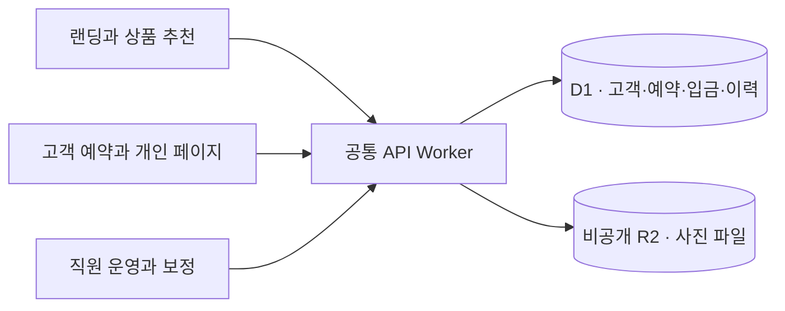
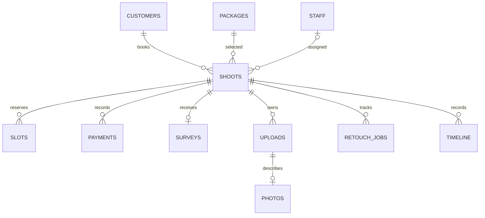

# 맨즈픽 DB와 아키텍처

## 한 건의 예약이 흐르는 곳

세 Next.js 앱은 사용자가 하는 일을 나누고, NestJS API Worker 하나가 인증·업무 규칙·저장 처리를 맡는다. 앱의 `/api`는 내부 Service Binding으로 API에 요청한다. 예를 들어 고객이 시간을 고르면 API가 가격과 배정 가능성을 다시 확인한다. 예약·슬롯·결제 기록이 저장된 뒤 직원은 같은 촬영 건을 조회한다. [API 진입점](../apps/server/src/http/app.ts) · [Cloudflare Service Binding](https://developers.cloudflare.com/workers/runtime-apis/bindings/service-bindings/http/)

NestJS 기능 모듈과 컨트롤러가 요청을 분리하고 공통 가드가 세션과 역할을 검사한다. 기존 업무 함수와 D1/R2 저장 처리는 유지한다. Workers의 Node HTTP 호환 계층과 요청별 AsyncLocalStorage로 원본 요청과 Cloudflare 바인딩을 연결한다. [전환 구조와 검증](reference/21-nestjs-migration.md)

## DB 관계와 제약

이 그림은 현재 SQL의 대표 관계다. D1은 고객·촬영·예약 시간·입금·사진 관계를 외래키로 연결한다. `shoots.package_snapshot`과 `shoot_addons.unit_price`는 예약 시점 상품과 금액을 보존한다. `uploads`는 객체 키와 형식·크기·공개 상태를 갖고, 사진 바이트는 R2에 있다. [현재 마이그레이션](../infra/migrations/) · [로컬 가상 데이터](../infra/seed.sql)

| 상황                                     | 코드의 보호 장치                                                                                                                 | 확인할 증거                                                                                        |
| ---------------------------------------- | -------------------------------------------------------------------------------------------------------------------------------- | -------------------------------------------------------------------------------------------------- |
| 두 고객이 같은 담당자의 같은 시간을 선택 | DB의 `UNIQUE(director_id,date,time)`과 실제 시간 겹침 조건을 함께 적용한다. D1 batch 안에서 고객·촬영·슬롯·결제·이력을 처리한다. | 동시 접수에서 한 건만 성공하고 실패한 요청의 잔여 기록이 없는지 검사한다.                          |
| 직원 두 명이 같은 촬영을 변경            | 저장 시점에 촬영의 `version`과 업무 조건을 검사한다. 바뀐 버전으로는 먼저 읽었던 화면의 변경을 그대로 덮어쓰지 못한다.           | 충돌 응답과 롤백, 성공 건의 이력을 검사한다.                                                       |
| 상품 단가나 옵션을 바꿈                  | 현재 판매 가격과 기존 예약의 스냅샷을 분리한다.                                                                                  | 변경 이후 신규 예약과 이전 예약에서 각각 올바른 금액을 확인한다.                                   |
| 다른 고객이 파일 주소를 알아냄           | 서버가 세션과 촬영 소속, 배정, 공개 상태를 확인하고 허용된 객체만 스트리밍한다. 고객 원본은 후기 승인 후 공개할 수 있다.         | 로그인 없는 파일 요청과 타 촬영 요청이 거부되고, 보정가 응답에 연락처·내부 메모가 없는지 확인한다. |
| 입사·퇴사로 직원 권한 변경               | 역할이나 활성 상태 변경, 세션·미사용 링크 회수, 감사 기록을 함께 저장한다.                                                       | 권한 변경 직후 기존 세션 차단과 감사 이력 저장을 확인한다.                                         |

[예약 저장](../apps/server/src/booking/start.ts) · [변경 보호](../apps/server/src/database/mutations.ts) · [파일 권한](../apps/server/src/files/access.ts) · [서버 회귀 테스트](../tests/backend.test.ts) · [D1 batch 동작](https://developers.cloudflare.com/d1/worker-api/d1-database/)

## 2026-11-10 검증 결과

- **설치와 관계 검사.** 빈 SQLite에 마이그레이션 8개와 가상 데이터를 적용했다. 업무·인증 등을 위한 테이블 43개가 생성됐고 무결성 검사 결과는 `ok`, 외래키 위반은 0건이었다.
- **기존 DB 갱신.** 격리된 D1에서 `0004`까지 적용한 DB에 가상 예약과 기존 직원 세션을 넣고 `0008`까지 순차 적용했다. 기존 예약·결제·사진 행과 세션 행이 유지됐고 외래키 위반은 0건이었다.
- **로컬 D1·R2.** Workerd의 격리된 저장소에도 같은 마이그레이션과 시드를 적용했다. SQL 제약 오류를 내면 D1 batch 전체가 롤백됐다. 같은 담당자의 같은 슬롯에 예약 두 건을 보내 `201`과 `409`를 하나씩 받았다. 해당 슬롯·결제도 각각 하나만 저장됐다. 다른 고객 촬영 조회는 `404`, 로그인 없이 파일을 열면 `401`이었다. 정상 세션은 업로드한 파일과 같은 바이트를 받았고 직원도 같은 촬영에서 업로드를 확인했다.
- **공개본 실행.** Yarn 4.18.1로 의존성을 고정 설치한 뒤 `yarn dev`와 `yarn test:local`을 통과했다. 랜딩, 예약, 고객 개인 링크, 직원 화면이 모두 열렸고 고객 앱에서 만든 가상 예약 한 건을 직원 앱의 입금 대기 목록에서 확인했다.
- **자동 검사.** Node.js 24.22.2에서 전체 테스트 108건과 랜딩 추천 테스트 2건을 통과했다. 서버 테스트는 가격 보존, 슬롯 충돌, 권한 거부, 계정 회수와 감사 기록을 다룬다. 운영 환경의 메일과 복구는 아래 기준으로 별도 확인한다.

## 운영 전 DB 검수 기준

1. **스키마 갱신.** 빈 DB 설치와 기존 스테이징 데이터에 다음 마이그레이션 적용을 각각 시험한다. 예약 수·금액·관계 무결성과 고객/직원 대표 흐름을 전후 비교한다.
2. **복구.** 변경 전 D1 복구 지점을 기록하고 격리된 환경에서 복원한다. 고객·촬영·입금 건수와 R2 객체의 다운로드를 함께 대조한다. D1의 시점 복구는 R2 파일을 복원하지 않으므로 객체 보존·복제와 삭제 절차를 따로 검증한다. [D1 시점 복구](https://developers.cloudflare.com/d1/reference/time-travel/)
3. **성능.** 대표 일정·직원 보드·촬영 상세의 쿼리 플랜과 읽은 행 수를 실제 예상 데이터 크기에서 측정한다. 예를 들어 현재 `timeline`의 촬영별 시간순 조회는 빈 스키마에서 전체 테이블을 읽고 별도로 정렬한다. 데이터가 늘어날 때 이 쿼리의 `shoot_id, created_at` 인덱스 효과를 전후 비교한다. [D1 쿼리 분석](https://developers.cloudflare.com/d1/observability/find-expensive-queries/)
4. **권한과 운영.** 운영 데모 모드를 끄고 실제 직원 이메일과 회사별 도메인에서 로그인·회수·파일 거부를 시험한다. 연락처·인증 토큰·원본 링크를 운영 로그에서 제외하고, 파일 및 설문의 보존·삭제 정책을 확정한다.

## 다른 회사에 같은 뼈대를 납품하는 방법

먼저 같은 코드 버전에서 회사별로 따로 배포한다. 각 회사에 도메인, API Worker, D1, 비공개 R2, 메일 바인딩과 관리자 계정을 따로 둔다. 공유할 코드는 로그인·세션, 서버 권한 검사, 관리자 화면 틀, 파일 접근, 감사 기록이다. 촬영 예약·보정 상태처럼 업종에 특화된 규칙과 브랜드는 회사별 설정과 기능으로 구분한다.

두 번째 회사에서 직원 로그인, 권한이 제한된 업무 상세, 변경 감사 기록까지 작은 흐름을 연결한다. A의 로그인 쿠키·고객 링크·파일 ID가 B의 화면과 API에서 거부되는지 확인한 후 같은 버전 업데이트를 두 회사에 적용한다. 현재 스키마는 한 회사용이다. 여러 회사를 한 배포에서 받는 제품은 고객사 식별과 모든 접근 경로의 격리, 백업·과금·운영 책임을 별도로 설계하고 검수한다. [운영과 타사 재사용](reference/10-client-admin-architecture.md) · [D1 운영 한도](https://developers.cloudflare.com/d1/platform/limits/)
