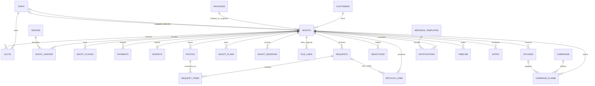
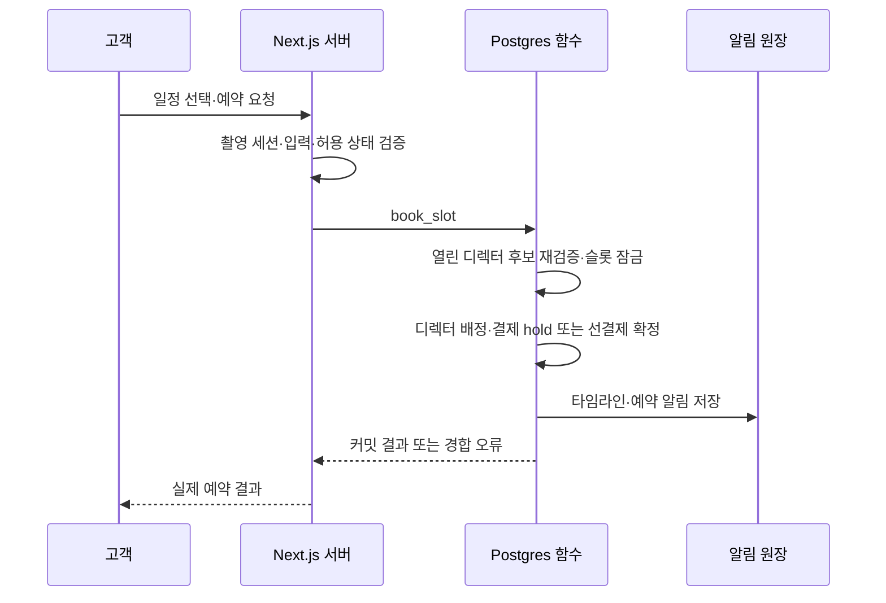

# 데이터 모델과 업무 흐름

> 최신 구현 기준: [Cloudflare 전환안](../07-cloudflare-architecture.md)을 적용한다. 아래 32개 업무 테이블과 불변 조건은 원문 논리 모델이며, Postgres 함수·RLS·Supabase Storage는 D1 batch/제약·API Worker 인가·private R2로 대체한다. 인증/멱등성 인프라 테이블은 추가될 수 있고 원본도 R2로 통합하므로 최종 물리 모델이 원문 32개와 같다고 가정하지 않는다.

작성일: 2026-11-06 · 상태: 실제 원문을 정리한 논리 설계. SQL·마이그레이션·애플리케이션 코드는 아직 작성하지 않았다.

## 1. 근거와 모델의 지위

제품 정책과 상태는 [Canonical Manspick OS v1.11](https://app.notion.com/p/Canonical-Manspick-OS-398af8f3d6b0817d9a84da6b2e770aca)을 기준으로 한다. 데이터 상세는 [Figma의 D4 데이터 모델 페이지](https://www.figma.com/design/cDXVLqZAaWwZeyIo5pqnNl/)에서 읽은 **DATA MODEL v0.4·초안**이다. 겉 레이어명은 데이터모델 v0.2로 남아 있으나 본문은 10월 4일 검토·2차 수정된 v0.4다. 이 차이를 별도 모델 두 개로 해석하지 않는다.

D4에는 32개 테이블이 제시돼 있다. 아래 표는 그 이름과 책임을 보존한다. 초안의 이름·필드 목록을 구현 완료된 DDL이나 승인된 모든 제약으로 간주하지 않는다. FK·인덱스·NOT NULL·삭제 정책·JSON 내부 스키마·고유성 범위는 구현 전에 계약을 확정해야 한다.

핵심 원장은 `shoots`다. 고객 한 명은 재방문 때 여러 촬영을 가질 수 있으므로 `customers 1:N shoots`다. 기존 고객 데이터의 이관은 이번 구축 범위에 포함하지 않는다. 고객에게 회원 가입 계정을 요구하는 별도 User 엔터티를 추가하지 않는다.

## 2. 32개 테이블과 책임

### 운영 기준·상품 — 8개

| 테이블            | 원문 책임·주요 내용                  | 설계상 확인점                                         |
| ----------------- | ------------------------------------ | ----------------------------------------------------- |
| staff             | 대표·직원·디렉터·보정가, role·active | Auth 사용자 연결, 퇴사 시 비활성화                    |
| director_skills   | 디렉터가 수행 가능한 서비스·업무     | 예약 가능 후보와 배정 조건의 기준                     |
| retoucher_rules   | 요일에 따른 보정가 배정 규칙         | 확정 시 사전 계산에 사용                              |
| director_days_off | 디렉터 휴무                          | 열린 슬롯과 배정 재검증에 반영                        |
| neighborhoods     | 동네·장소 운영 기준                  | 고객 최초 기본정보에 지역을 추가 수집하는 근거가 아님 |
| settings          | 운영 설정                            | 변경 권한·적용 시점·기존 예약 영향 확정 필요          |
| packages          | 패키지 가격·장수·벌수·시간 기준      | 예약 시 shoots에 스냅샷 보존                          |
| addons            | 대여·코디 제작 등 부가 옵션 기준     | 수량·가격·소요 시간 영향 확정                         |

### 고객·촬영·예약·결제 — 6개

| 테이블       | 원문 책임·주요 필드                                                                                                                                                                   | 관계·제약                                                         |
| ------------ | ------------------------------------------------------------------------------------------------------------------------------------------------------------------------------------- | ----------------------------------------------------------------- |
| customers    | 이름·전화번호, phone unique                                                                                                                                                           | 정규화된 번호로 중복 판단. customers 1:N shoots                   |
| shoots       | customer, access_token, status, package, total_amount, 예약 당시 가격·장수·벌수·시간 snapshot, director/retoucher, starts/ends, survey_due/outfit_due, select_by, cancelled_at/reason | 촬영별 개인 링크와 단일 진행 상태의 원장. stage는 status에서 파생 |
| shoot_addons | 촬영에 선택한 부가 옵션과 수량                                                                                                                                                        | shoots 하위. 상품 변경과 예약 당시 계약을 구분                    |
| shoot_places | 촬영에 연결된 장소                                                                                                                                                                    | shoots 하위. 장소 정보의 노출 범위 결정                           |
| payments     | kind: 본결제/설문추가/추가보정, channel, amount, depositor, state: 대기/확인/해제, held_until, confirmed_by                                                                           | 촬영별 복수 결제. 입금 확인이 예약·업무 상태와 함께 반영          |
| slots        | 디렉터별 예약 가능·잠금 슬롯                                                                                                                                                          | 촬영 시간·쇼핑 앞 시간·올데이 전체 시간의 경합 제어               |

### 설문·준비·접근·코디 — 5개

| 테이블          | 원문 책임·주요 필드                                          | 관계·제약                                  |
| --------------- | ------------------------------------------------------------ | ------------------------------------------ |
| surveys         | shoot PK, answers, page_done, submitted_at                   | 촬영별 1개. 임시 진행과 제출 완료를 구분   |
| uploads         | kind: 설문/의상/후기, path                                   | 촬영에 속한 고객 업로드, private Storage   |
| guide_checks    | 고객 가이드 확인 기록                                        | 확인 대상·완료 판정의 상세 필드 확정 필요  |
| access_attempts | 개인 링크 전화 뒤 4자리 확인 시도                            | 5회 실패·10분 잠금의 서버 판정 근거        |
| shoot_plans     | concept, outfits별 제안·참조 사진, 고객 공개 note, shared_at | 코디안과 고객 공개 시점. 내부 notes와 구분 |

### 촬영·사진·셀렉·보정 — 5개

| 테이블         | 원문 책임·주요 필드                                      | 관계·제약                                                |
| -------------- | -------------------------------------------------------- | -------------------------------------------------------- |
| shoot_sessions | steps, outfit_no, done_at                                | 촬영 당일 단계·의상별 완료 기록                          |
| file_links     | 원본 외부 드라이브 URL, version, visible                 | 원본만 외부 링크. visible은 해당 고객 공개 여부          |
| photos         | kind: 후보/보정/수정, path, cut_no, uploaded_by, visible | 후보·보정·수정본은 private Supabase Storage              |
| selections     | round: 기본/추가, picks, extra_count                     | 촬영별 셀렉 라운드와 선택 사진                           |
| retouch_jobs   | kind: 기본/수정/추가, request_id, state, due_at          | 실제 보정 작업. 담당 보정가 사전 배정과 작업 생성을 분리 |

### 요청·알림·이력·캠페인 — 8개

| 테이블            | 원문 책임·주요 필드                                                               | 관계·제약                                        |
| ----------------- | --------------------------------------------------------------------------------- | ------------------------------------------------ |
| requests          | type: 입금확인/수정/후기캡처/추가보정, state: 새요청/처리중/완료/반려, handled_by | 고객 요청의 처리 원장                            |
| request_items     | photo_id, comment                                                                 | 수정 요청 1개 안의 사진별 의견 N개               |
| message_templates | key, title, body, stageconditions, auto, alimtalk_code                            | 단계·조건별 알림톡 템플릿                        |
| notifications     | send_at, state: 대기/발송/실패/취소, sent_by, provider_msg_id                     | 예약·수동·자동 발송 원장. 아키텍처의 outbox 역할 |
| timeline          | from/to, actor, reason                                                            | 상태 변경·처리 이력, 사유 추적                   |
| notes             | 내부 업무 메모                                                                    | 고객 공개 note와 구분, 역할별 접근               |
| campaigns         | 후기·추천 등 캠페인 기준                                                          | 정책·혜택·적용 조건의 별도 계약 필요             |
| campaign_claims   | campaign, shoot, upload, referrer, state, handled_by                              | 촬영별 캠페인 신청·처리. 후기 처리에서 생성      |

`notifications`를 지속 가능한 발송 원장으로 사용한다. outbox라는 설명 때문에 원문에 없는 33번째 필수 업무 테이블을 별도로 확정하지 않는다. 재시도·처리 선점 등 운영 필드는 설계 보완이며 원문 필드와 구분해 마이그레이션 검토에 올린다.

## 3. 핵심 관계 ERD

다음 도식은 원문 책임을 연결한 논리 관계다. 모든 필드·보조 테이블을 나열하는 물리 ERD는 아니다.

특히 selections.picks·surveys.answers·shoot_plans.outfits의 JSON 구조, 동일 촬영 내 버전 수와 최신본 판정은 아직 물리 제약으로 확정되지 않았다. 어떤 저장 형태를 선택하든 다른 촬영의 사진·업로드·요청을 연결할 수 없어야 한다. Auth 사용자와 staff 연결, 리퍼러의 참조 대상도 상세 계약이 필요하다.

## 4. 상태 원장과 하위 업무 상태

촬영 진행은 `shoots.status` 하나가 원장이다. **30개 상태와 별도 취소 상태의 전체 명칭·순서는 [PRD의 Canonical 상태 정의](../01-product-requirements.md)를 참조한다.** 이 문서에 다른 임의 상태 목록을 중복 정의하지 않는다. 고객 화면의 stage와 직원 보드 구간은 status에서 계산하며 별도로 수정 가능한 원장으로 두지 않는다.

결제 대기/확인/해제, 요청 새요청/처리중/완료/반려, 알림 대기/발송/실패/취소, retouch_jobs의 작업 상태는 각 하위 업무의 상태다. 이 값으로 촬영 전체 상태를 임의 추측해 변경하지 않고 명시된 전이 함수가 함께 갱신한다.

기본은 순서대로 전이한다. admin/staff가 스킵·역행할 때는 사유를 남긴다. 시스템 예외는 선결제·hold 만료·D-1 미설문 세 가지다. 취소는 별도 상태와 cancelled_at/reason으로 기록하고 기본 운영 보드에서 숨긴다. 보드에서 숨긴다는 이유로 원장·결제·이력을 삭제하지 않는다.

## 5. 접수·예약·결제 흐름

고객 순서는 옵션 → 기본정보 → 일정 → 결제 → 설문이다. 기본정보는 이름·번호·결제 경로와 금액이며 지역을 필수 항목으로 추가하지 않는다. 공개 `/start` 접수 후 customers·shoots·access_token을 생성하고 `/s/{token}`에서 전화 뒤 4자리를 확인한다. 세션·역할 경계는 [계정·권한](../reference/02-accounts-and-permissions.md)을 따른다.

이미 있는 번호의 진행 중 촬영을 중복 생성하지 않는다. 고객 존재 여부나 개인 링크를 접수 응답에 노출하지 않고, 기존 링크를 해당 번호로 발송한다. 같은 번호지만 진행 중 촬영이 없으면 기존 customer 아래 새 shoot를 생성한다. 고객 기록이 하나라고 재방문 촬영까지 하나로 제한하지 않는다. 진행 중으로 판단하는 상태 범위와 원자적 중복 검사는 상세 API 계약에 명시한다.

고객에게 보이는 일정은 열린 디렉터 슬롯의 합집합이다. 서버 함수 안에서 가능한 디렉터를 정하고 관련 슬롯을 함께 확보한다. 일반 촬영의 시간에 더해 동행 쇼핑은 촬영 2시간 전의 존재하는 앞 슬롯을 잠근다. 올데이는 하루 4개 슬롯을 잠근다. 기본 슬롯은 11·13·15·17시이며 8주 앞까지 매일 생성한다.

**11시 촬영의 09시 쇼핑은 별도 슬롯 잠금이 필요하지 않다.** [원문 의사결정](https://app.notion.com/p/3eeaf8f3d6b081e4b0cfe9bf21749438)은 09시 기본 슬롯이 없으므로 잠금 불필요라고 명시한다. 13시 촬영의 쇼핑은 11시 슬롯을 잠근다. 기존 미결은 이 결정으로 해소하며 09시 리소스를 새로 만들거나 11시 조합을 차단하지 않는다.

계좌이체 hold 만료는 `min(예약 시각 + 24시간, 촬영 시각 - 2시간)`이다. 선결제는 즉시 확정한다. 예약 확정 시 요일 규칙으로 보정가를 사전 계산하되, 실제 retouch_jobs는 셀렉 완료 시 생성한다. 예약만으로 빈 보정 작업을 미리 만들지 않는다.

hold 해제는 관련 슬롯 해제·director 비우기·예약된 알림 취소를 함께 처리한다. 촬영 취소는 슬롯·미발송 알림 정리와 취소 사유·이력을 같은 전이로 처리하되 **director_id 유지 여부는 출처 충돌로 미결**이다. Notion ERD v0.4는 기록용 유지, Canonical v1.11과 10/3 의사결정 로그는 해제로 적었다. 설계 제안은 현재 배정을 해제하고 과거 담당자는 timeline에 보존하는 것이다. 운영 결정 전 이를 확정 필드 정책으로 구현하지 않는다. 기존 결제의 확인/해제 및 환불 정책은 별도 결제 규칙을 따른다. 취소를 환불 성공으로 자동 표시하지 않는다.

## 6. 설문·의상·코디 준비

surveys는 shoot를 기본 키로 하며 answers와 page_done으로 작성 중 진행을 보존하고 submitted_at으로 제출 완료를 구분한다. 고객의 의상·설문 사진은 uploads에 기록한다.

의상 사진이 필요한 수량은 다음 원문 규칙을 사용한다.

`필요 수량 = max(0, 패키지 벌수 - 대여 수량 - 1코디 제작 수량)`

이 수량은 고객이 준비해야 하는 의상 사진의 필요량이다. 셀렉할 사진 장수나 보정 컷 수와 혼용하지 않는다. 옵션별 수량과 단위를 입력 계약에 고정한다.

기본 설문 마감은 D-3, 의상 마감은 D-2다. 근접 예약으로 이미 지났으면 전날 20시로 조정하고 그 시각도 지났으면 즉시 마감으로 처리한다. 각 마감의 정상 기준 시각·서버 기준 시간대는 상세 정책 계약으로 고정해야 한다. D-1 미설문 자동 전이는 허용된 시스템 예외에만 적용한다.

촬영 설계는 설문 제출이 없어도 진행할 수 있다. 데이터가 부족하다는 이유로 코디안 작성 기능 전체를 차단하지 않는다. 공유할 concept·outfits별 제안과 참조 사진·고객 공개 note·shared_at을 shoot_plans에 보관하고 share_plan이 상태·타임라인·알림을 반영한다.

## 7. 촬영·파일·셀렉·보정·수정

shoot_sessions는 당일 steps·outfit_no·done_at을 기록한다. 원본은 외부 드라이브 file_links, 후보·보정·수정본은 photos와 private Supabase Storage를 사용한다. file_links.version과 visible, photos.visible을 실제 고객 공개 판단에 반영한다. 내부 직원에게 보인다는 이유로 고객에게 바로 공개하지 않는다.

셀렉은 selections의 기본/추가 round, picks, extra_count로 구분한다. submit_selection은 해당 촬영의 선택 가능 사진·수량·현재 단계·기존 제출 여부를 검증하고 필요한 retouch_jobs를 원자적으로 만든다. 추가 보정 결제와 작업 생성 조건은 명시된 결제/상태 규칙을 따라야 한다.

수정은 requests의 수정 type 한 건에 request_items 여러 개를 포함한다. 사진별 의견이 N개여도 수정 요청 한 건은 1회로 센다. 최대 3회는 사진 의견 수가 아닌 요청 횟수에 적용하며, 동시 제출로 4번째 요청이 생기지 않도록 함수 안에서 검사한다. 반려·취소·재제출을 횟수 집계에서 어떻게 다룰지는 상세 정책을 확정해야 하며 화면만으로 임의 차감하지 않는다.

request_revision은 요청·항목·수정 작업·촬영 상태·이력·알림을 함께 반영한다. 보정가에게는 자신 retouch_jobs와 작업에 필요한 마스킹 정보만 제공한다. 이름·연락처·설문 상세를 보정 작업 DTO에 포함하지 않는다.

후기 캡처 요청이 완료되면 campaign_claims를 자동 생성하고 원본을 고객에게 공개한다. claim 생성·요청 완료·원본 visible 변경·타임라인·알림 예약이 부분 성공하지 않도록 resolve_request에서 함께 처리한다. 이 고객 공개를 마케팅 목적의 외부 공개 동의로 해석하지 않는다.

## 8. 원자적 처리 경계

원문은 중요 변경을 서버 검증 후 DB 함수로 실행하도록 설계했다. 원문의 함수는 book_slot, confirm_payment, release_hold, cancel_shoot, share_plan, submit_selection, request_revision, resolve_request, change_status다. 현재 서버의 원자적 저장 경계는 [Cloudflare 아키텍처](../07-cloudflare-architecture.md#7-예약과-중요-변경의-원자성)를 따른다.

| 묶음           | 한 번에 커밋하거나 함께 롤백할 변경                                                                                                                            |
| -------------- | -------------------------------------------------------------------------------------------------------------------------------------------------------------- |
| 예약·확정      | shoots 상태·담당·시각·snapshot, 관련 slots, payments, timeline, notifications                                                                                  |
| hold 해제      | 관련 slots 해제, director 비우기, 상태·결제 정책에 따른 변경, 미발송 알림 취소, timeline                                                                       |
| 촬영 취소      | 관련 slots 해제, 상태·취소 사유, 결제 정책에 따른 변경, 미발송 알림 취소, timeline. director_id 유지/해제는 미결이며 현재 배정 해제+과거 담당 이력 보존을 제안 |
| 셀렉 제출      | selections, 해당 retouch_jobs, shoots.status, timeline, notifications                                                                                          |
| 수정 요청      | requests, request_items, 해당 retouch_jobs, 횟수 검증, 상태·이력·알림                                                                                          |
| 요청 처리      | 요청 처리자·상태, 연관 업무 변경, 후기면 claim 생성·원본 공개, timeline, notifications                                                                         |
| 상태 수동 조정 | 이전/다음 상태 검증, 권한·사유, 관련 업무 정합성, timeline·알림                                                                                                |

외부 드라이브·Storage 객체·알림 업체는 DB와 하나의 트랜잭션으로 커밋되지 않는다. 파일 저장 후 메타데이터 반영 실패, DB 커밋 후 발송 실패를 별도 복구 경로로 처리해야 한다. DB 기록만으로 파일 존재나 실제 발송 성공을 단정하지 않는다. 알림 성공은 provider 응답 또는 수동 발송 확인 기록에 따라 갱신한다.

설계 보완으로 중복 요청 식별·결과 재사용, 사진/요청의 촬영 일치 검증, DB 제약·행 잠금, 실패 알림 재시도와 처리 선점, 고아 파일 정리·정합성 점검을 둔다. 필요한 운영 필드는 원문의 초안과 구분해 검토한다.

## 9. 불변 조건과 검증 사례

| 불변 조건                              | 반드시 검증할 경합·실패 사례                                                    |
| -------------------------------------- | ------------------------------------------------------------------------------- |
| 한 리소스 시간에 겹치는 활성 예약 없음 | 두 고객 동시 예약, 올데이와 단일 촬영, 쇼핑 앞 슬롯 충돌                        |
| 고객 한 명의 재방문은 여러 촬영 가능   | 동일 번호 동시 접수 중복 방지, 완료 후 재방문, 진행 중 여부 비노출              |
| 예약 계약은 snapshot으로 보존          | 예약 후 패키지 가격·장수·벌수·시간 변경 시 과거 계약 불변                       |
| 촬영 진행 상태는 단일 원장             | stage 임의 수정 거부, 권한 없는 스킵·역행 거부, 사유 필수, 시스템 예외 3개 제한 |
| 해제·취소 후 자원·알림 정합성          | hold 만료와 입금 확인 경합, 재실행, 부분 실패 롤백                              |
| 사진·선택·요청은 같은 촬영 소속        | 다른 촬영 photo_id·upload·request_id 주입 거부                                  |
| 수정 요청 최대 3회                     | 다수 사진 의견은 1회, 세 번째와 네 번째 동시 제출, 재전송 중복 생성 방지        |
| 셀렉 완료와 작업 생성은 일치           | 중복 셀렉 제출로 작업이 늘지 않음, 생성 실패 시 제출도 롤백                     |
| 후기 완료와 혜택·공개는 일치           | 요청 재처리 시 claim 중복 없음, claim 실패 시 원본만 먼저 공개되지 않음         |
| private 파일·역할 범위 유지            | 다른 고객·미배정 디렉터·보정가의 민감 데이터 및 파일 발급 차단                  |
| 발송 상태는 실제 처리와 일치           | 중복 cron, 지연, provider 장애, 수동 큐와 자동 발송 중복 방지                   |

## 10. 구현 전 확정할 상세 계약

- 32개 테이블의 정확한 열 이름·타입·기본값·FK·삭제 정책·인덱스·RLS·GRANT와 역할별 뷰 정의.
- status 30개와 취소의 DB 값, stage 계산표, 전이별 필요한 하위 데이터 조건. PRD/Canonical과 한 번만 정의한다.
- 진행 중 촬영으로 판단할 상태 범위, 전화번호 정규화·번호 변경·토큰 재발급. 진행 중 촬영이 없는 재방문은 같은 customer에 새 shoot를 생성한다.
- 겹침 시간 구간과 director_skills·휴무 변경 처리. 11시 촬영의 09시 쇼핑 잠금 불필요는 원문 결정으로 확정한다.
- 취소 시 director_id 보존/해제 충돌, 현재 배정과 과거 담당 이력의 저장·권한·전이 처리.
- 기본 D-3/D-2 마감 시각, 기한 계산의 시간대·당일 예약 허용 범위.
- surveys.answers·page_done, plans.outfits, selections.picks의 내부 구조·수량·버전·수정 가능 시점.
- 반려·철회된 수정 요청의 3회 한도 집계, 추가 보정 결제와 추가 작업 생성 조건.
- 환불·재입금·오입금·금액 정정·결제 확인 취소의 상태와 권한. payment.state만으로 실제 자금 이동을 대체하지 않는다.
- file_links·photos의 최신 버전·공개 철회, Storage/원본 보존·삭제·서명 URL 만료와 외부 드라이브 접근 정책.
- 알림톡 업체·템플릿 승인·발송 성공 판정·재시도·수동 처리·실행 이력의 구체 필드.

미결 항목을 임의 기본값으로 채운 스키마를 먼저 만들지 않는다. 먼저 원문 규칙·상태·권한과 이 문서의 불변 조건을 맞춘 뒤 마이그레이션 계약을 작성한다.
