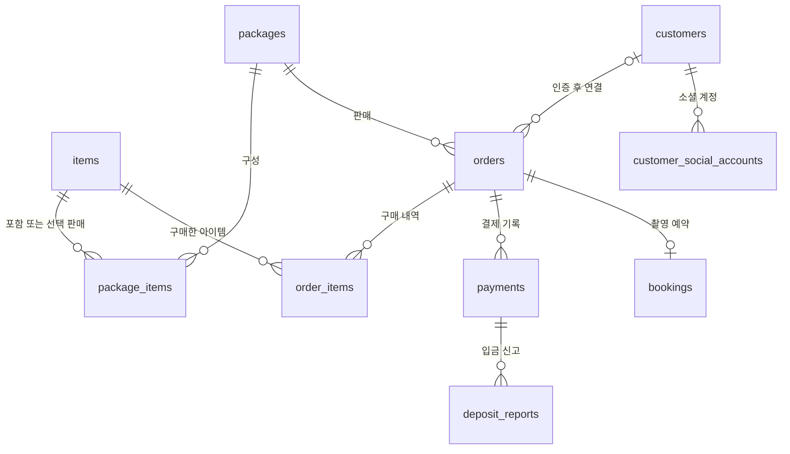
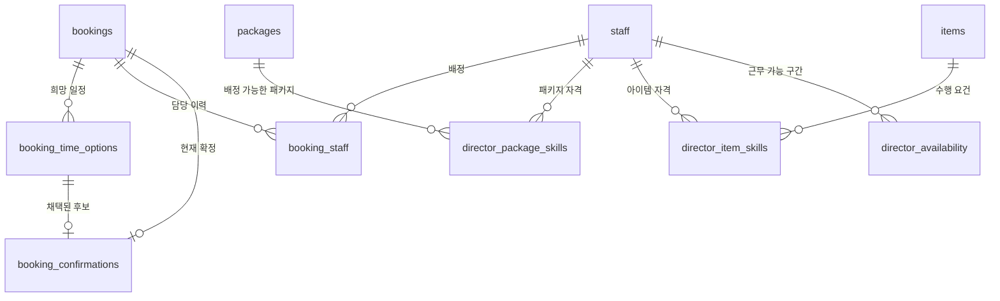

# 예약과 운영 데이터

한 고객이 ‘하이브리드 + 의상 대여’를 고르고 화요일과 토요일을 희망하면 주문 1건, 예약 1건, 희망 일정 2건이 생긴다. 디렉터가 토요일을 확정해도 주문 금액과 처음 제출한 두 후보를 보존한다. 아래는 이 흐름에서 함께 읽고 쓰는 데이터다. 컬럼·외래키·인덱스·트리거의 정의는 [D1 스키마](../infra/migrations/)에서 확인한다.

## 주문과 수납

- `package_items`는 패키지에 포함된 수량과 선택 가능한 아이템을 정한다. 주문에는 구매 당시 패키지명·금액·소요 시간과 아이템별 이름·수량·단가를 저장한다. 상품을 편집해도 기존 주문의 구매 내역은 유지된다.
- 판매 경로와 외부 플랫폼 닉네임은 주문에, 카카오·구글 계정은 고객에 연결한다. 인증 전에는 주문의 `customer_id`가 비어 있을 수 있다.
- 크몽·숨고·프립·스마트스토어에서 이미 결제한 고객은 플랫폼 닉네임과 희망 일시를 제출하면 예약이 완료된다. 주문에는 상품 구성의 총액과 판매 경로·닉네임을 보관한다. 고객이 외부 플랫폼에서 지불한 금액을 입력하면 새 결제 기록에 그 금액을 저장한다. 이때의 `confirmed_at`은 맨즈픽의 예약 처리 시각이다. 외부 플랫폼 선결제는 맨즈픽 자체 수납 건수에서 제외한다.
- 직접결제의 완료 시점은 결제 승인이다. 로컬·고객 테스트 환경에서는 명시적으로 모의 결제를 승인하면 서버가 표시 금액을 주문 총액과 대조하고, 거래 번호와 승인 시각을 기록하면서 예약을 설문 단계로 전환한다. 결제 기록의 `provider`는 `test_checkout`이며, 결제사와 거래 번호의 조합은 유일하다. 촬영 일정은 설문 제출 후 담당 디렉터가 확정한다.
- 기존 계좌이체 예약은 `deposit_reports`에 입금자명, `requests`에 신고 원문을 보관한다. 직원이 입금을 확인하면 `payments`에 확인 시각과 담당자가 기록된다.

## 배정과 일정 확정

1. 희망 일정은 예약 안에서 중복될 수 없고 제출만으로 슬롯을 점유하지 않는다. 서버는 신청 아이템 자격이 있고 후보 중 한 곳에서 필요한 시간 전체를 확보할 수 있는 디렉터를 찾는다. 입사일이 빠른 순서로 배정하며 동률이면 직원 ID로 결정한다. [예약 접수](../apps/server/src/booking/start.ts) · [디렉터 조회](../apps/server/src/booking/directors.ts)
2. `booking_staff.released_at`이 비어 있는 행이 현재 배정이다. 한 예약에 담당 디렉터는 최대 한 명이다. 변경 전 담당자는 해제 시각과 함께 남는다.
3. 설문 제출 후 담당 디렉터가 예약에 속한 미래 후보 하나와 장소를 확정한다. 같은 트랜잭션에서 현재 담당자, 이전 확정, 자격·가능 시간·점유 충돌을 다시 확인하고 확정·슬롯·안내·이력을 기록한다. 후보 시작 시각이 달라도 점유 구간이 겹치면 확정할 수 없다. [일정 확정](../apps/server/src/shoots/commands/schedule-confirmation.ts)

## 촬영 운영

| 데이터                                             | 용도                                                                                                                                   |
| -------------------------------------------------- | -------------------------------------------------------------------------------------------------------------------------------------- |
| `shoots`, `bookings`, `orders`                     | 촬영 상태·버전, 예약, 주문. 현재 서버는 세 행에 같은 ID를 부여한다. `bookings.order_id`는 유일하고 `bookings.id`는 촬영 ID를 참조한다. |
| `booking_surveys`, `shoot_briefs`, `booking_tasks` | 예약별 설문 응답과 제출 시각, 디렉터의 촬영 기획, 담당자별 할 일.                                                                      |
| `booking_notes`, `booking_events`, `audit_events`  | 직원 메모, 촬영 상태 변경 이력, 계정·설정·템플릿 변경 전후 값과 행위자.                                                                |
| `uploads`, `booking_photos`                        | 파일 본문은 비공개 R2에 둔다. 내부 사진을 업로드하면 D1에 사진의 예약·객체 키·원래 이름·크기·업로더를 함께 기록한다.                   |
| `booking_notices`, `staff_notifications`           | 고객에게 안내한 당시 문구와 시각, 예약 담당 직원별 알림 대기 건. 담당 해제 시 해당 직원의 남은 배정을 확인해 대기를 취소한다.          |
| `campaigns`, `campaign_entries`                    | 캠페인 정의와 예약별 참여. 같은 예약은 동일 캠페인에 한 번 참여할 수 있다.                                                             |
| `analytics_events`                                 | 회원 가입 전부터 익명 방문 식별자로 랜딩·주문·인증·설문 이벤트를 연결한다. [지표 집계 기준](product-requirements.md#지표-확인-페이지)  |

기존 SQL에서 사용하는 `addons`, `surveys`, `shoot_plans`, `notes`, `timeline`, `director_skills`는 현재 테이블을 가리키는 호환 뷰다. 뷰와 트리거를 변경할 때는 기존 촬영과 업로드가 새 경로에서도 조회·저장되는지 확인한다. [예약 DB 테스트](../tests/booking-operations.test.ts)
