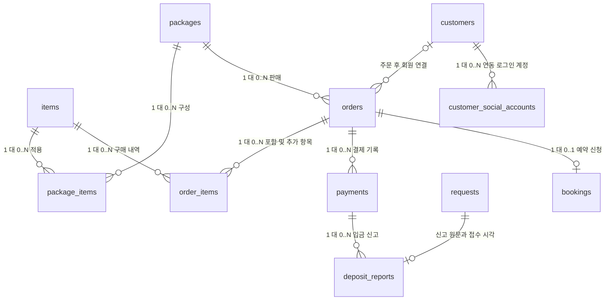
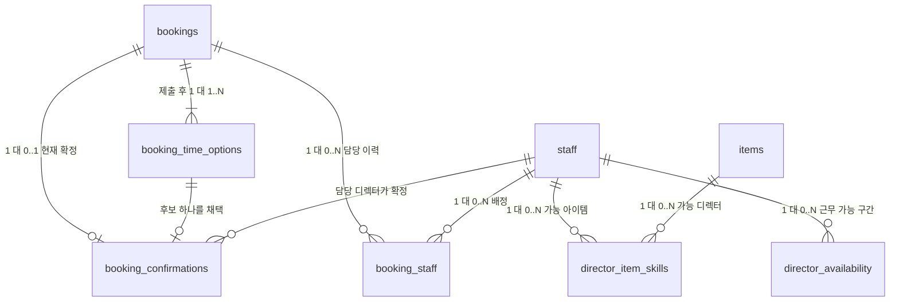
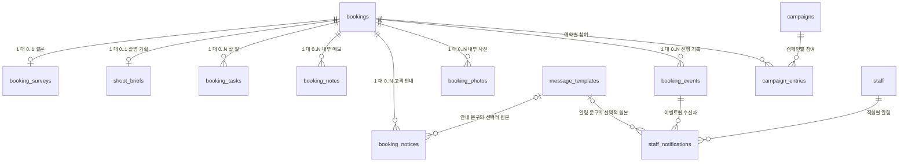

# 맨즈픽 예약·운영 DB

2026-11-27에 적용한 예약·운영 DB의 업무 모델이다. [현행 제품 요구사항](../01-product-requirements.md)에 복수 희망 일정, 어드민 상품 편집, 내부 사진 보관, 캠페인 운영을 반영했다. 실제 배포 스키마는 [마이그레이션](../../infra/migrations/)에서 확인한다.

그림은 왼쪽 한 행에 오른쪽 행이 몇 개 연결되는지 표시한다. `0..1`은 선택적 한 건, `1..N`은 적어도 한 건, `0..N`은 없거나 여러 건이다. 연결 테이블의 양쪽을 보면 N:M 관계를 읽을 수 있다.

## 1. 판매 패키지, 구성 아이템, 주문, 결제

| 테이블                     | 한 행의 의미와 주요 컬럼                                                                                                                                                                                                                                                                                       |
| -------------------------- | -------------------------------------------------------------------------------------------------------------------------------------------------------------------------------------------------------------------------------------------------------------------------------------------------------------- |
| `packages`                 | 어드민이 판매하는 패키지 하나. `id`, `name`, `price_krw`, `shoot_duration_minutes`, `is_active`. 올데이의 전일 점유는 별도 예약 규칙으로 관리한다.                                                                                                                                                             |
| `items`                    | 여러 패키지에서 재사용하는 아이템 하나. `id`, `name`, `unit_price_krw`, `active`. 디렉터 동행 등 배정에 영향을 주는 조건도 관리한다.                                                                                                                                                                           |
| `package_items`            | 어느 패키지에 어느 아이템을 기본 포함하거나 추가 판매하는지 아이템당 한 행으로 기록한다. 기본키는 `(package_id, item_id)`. `inclusion_type`과 `quantity`를 둔다. 기본 포함 항목이면 제공 수량, 선택 판매 항목이면 해당 패키지의 구매 상한이다.                                                                 |
| `orders`                   | 주문 한 건이 선택한 패키지는 정확히 하나다. `orders.package_id`는 필수 외래키이며, 여러 주문이 같은 패키지를 참조할 수 있다. 주문에는 주문 당시 패키지명·기본 가격·촬영 시간을 복사한다. `sales_channel`과 외부 플랫폼 닉네임은 소셜 로그인 정보와 따로 둔다. 주문 직후에는 `customer_id`가 비어 있을 수 있다. |
| `order_items`              | 그 주문에 실제로 포함되거나 추가된 아이템. `order_id`, `item_id`, 당시 이름·수량·청구 단가를 저장한다. 기본 포함분의 추가 청구액은 0원이다. 현재 카탈로그에서는 한 패키지 안의 한 아이템을 기본 포함 또는 선택 판매 중 하나로 지정한다.                                                                        |
| `payments`                 | 주문의 결제 출처·거래 식별자·금액·처리 상태·확정 시각. PG·실발송 업체는 아직 미선정이며 테스트에서는 직원이 가상 수납을 확인한다. 외부 거래 식별자에는 공급자별 유일 제약이 있다. 외부 플랫폼은 닉네임 접수와 결제 확인 근거를 구별한다. 확정 건수는 확정된 거래만 집계한다.                                   |
| `customer_social_accounts` | 카카오·구글 계정과 회원의 연결. `UNIQUE(provider, provider_subject)`를 두고 인증 완료 후 같은 주문 세션에서 주문을 회원에게 귀속한다.                                                                                                                                                                          |

예를 들어 어드민이 하이브리드에 ‘의상 대여’와 ‘동행 쇼핑’을 선택 가능 항목으로 등록하면 `packages`에는 하이브리드 1행, `package_items`에는 하이브리드를 가리키는 2행이 있다. 이 두 행을 모은 것이 하이브리드의 구성표 하나다. 고객이 하이브리드와 의상 대여만 구매하면 `orders.package_id`는 하이브리드 하나를 가리키고, 두 선택 가능 항목 중 의상 대여만 `order_items`에 남는다.

**주문은 구매 내역이고, 예약은 그 구매로 진행할 촬영 일정이다.** 주문 화면에서 고객이 ‘하이브리드 + 의상 대여’를 고르고 화·토 두 날짜를 제출하면 주문 1건, 예약 신청 1건, 희망 일정 2건이 생긴다. 디렉터가 토요일을 확정하면 기존 예약에 확정 일정만 기록한다. 어드민은 한 고객 화면에서 ‘구매 내역’과 ‘촬영 일정’을 함께 보여줄 수 있다.

이번 설계는 한 주문이 한 촬영 예약을 만드는 판매 단위를 가정한다. 주문 작성 중에는 예약이 0건이고, 희망 일정 제출 후 1건이다. `bookings.order_id`에 `UNIQUE NOT NULL`을 둔다. 일정이나 장소가 바뀌어도 주문 당시 금액이 달라지지 않는다. 계좌이체 신고는 `deposit_reports(request_id, payment_id, reported_depositor)`에 저장한다. 접수 시각은 요청의 `created_at`으로 확인한다. 고객이 신고해도 결제 상태는 대기이며 직원이 수납을 확인해야 `payments.confirmed_at`과 확인자가 기록된다.

예시 DB의 원은 90분, 하이브리드는 120분, 올데이는 300분이다. 올데이는 [공개 랜딩](../../apps/frontend-landing-page/src/features/landing/source-offer.tsx)에서 ‘5시간 이상’으로 안내한다. 예약 가능성을 검사할 때는 주문 당시 촬영 시간에 아이템의 동행 시간과 패키지의 점유 규칙을 함께 적용한다. 기존 데모에서 올데이는 영업 슬롯 전체를 점유한다. [상품 예시](../../infra/seed.sql) · [점유 계산](../../packages/domain/src/booking.ts)

## 2. 고객의 후보 제출, 디렉터 배정, 최종 확정

1. 고객이 주문 화면에서 희망 일시를 여러 개 제출한다. `booking_time_options(id, booking_id, starts_at)`에 후보당 한 행을 쓰고, `UNIQUE(booking_id, starts_at)`로 중복을 막는다. 모든 후보를 점유 처리하면 다른 고객의 선택지를 불필요하게 막으므로 후보는 희망만 나타낸다.
2. 신청 아이템을 수행할 수 있고 후보 중 하나 이상의 **필요 시간 전체**가 비는 디렉터를 찾는다. 이들 중 `staff.hired_on`이 가장 이른 사람을 배정한다. 같은 입사일이면 직원 ID로 순서를 정한다. `booking_staff`는 배정·해제 시각을 보존하며, 예약당 현재 담당 디렉터는 최대 한 명이다.
3. 배정된 디렉터가 고객 후보 하나를 선택한다. `booking_confirmations(booking_id PK, option_id, confirmed_by_staff_id, confirmed_at, location, occupancy_starts_at, occupancy_ends_at)`에 현재 확정을 기록한다. 복합 외래키 `(booking_id, option_id)` → `booking_time_options(booking_id, id)`로 다른 예약의 후보 선택을 막는다. 부모 쪽에 같은 조합의 유일 키를 둔다.
4. 확정 트랜잭션에서 현재 배정, 후보, 가용 시간과 기존 확정 건의 점유 구간 겹침을 다시 검사한다. 같은 디렉터가 13:00~15:00에 점유되면 14:00 시작도 막아야 한다. 검사·확정·진행 이벤트·알림 대기 생성을 함께 커밋한다. 일정 변경 시에는 새 시간 확보에 성공한 경우에만 현재 확정을 교체하고, 전후 값은 이력에 남긴다.

## 3. 촬영 준비, 어드민 기록, 안내, 캠페인

- **고객별 준비**. `booking_surveys`는 주문 후 인증한 회원이 해당 예약에서 제출하는 설문이다. 양식 버전·응답·제출 시각을 보존한다. `shoot_briefs`는 디렉터가 특정 고객과 합의한 컨셉·복장·동선이고, `packages`는 어드민이 판매하는 상품이다. `booking_tasks`에는 담당자와 완료 시각을 둔다.
- **내부 기록**. `booking_notes`는 직원이 쓴 메모이고, `booking_events`는 누가 언제 무엇을 바꿨는지 남기는 추가 전용 이력이다. 관리자 상품·계정 변경도 추적하려면 별도 `audit_events`에 변경 주체와 변경 전후 값을 보존한다.
- **사진**. `booking_photos(id, booking_id, object_key, original_filename, mime_type, size_bytes, uploaded_by_staff_id, uploaded_at)`에 파일당 한 행을 둔다. 파일 본문은 비공개 저장소에, 썸네일·원본 접근 권한은 서버에 둔다. 어드민은 예약별 썸네일·파일명·업로더·날짜를 조회한다. 기존 설명의 ‘12번 컷’은 한 촬영 안에서 사진에 붙인 예시 번호였다. 이번 모델에서는 사진 ID만 필요하다. 고객 파일 전달은 네이버 클라우드, 보정 대화는 카카오톡에서 진행한다.
- **안내와 알림**. `booking_notices`는 고객이 자기 예약에서 볼 확정 시간·장소·준비 안내다. 공유 당시의 안내 본문과 시각을 보존해 템플릿 수정 후에도 무엇을 안내했는지 확인할 수 있다. `staff_notifications`는 배정·확정 이벤트별로 담당 직원의 개인 카카오톡에 발송할 한 건이다. 이벤트·직원·종류 조합을 유일하게 하고 대기 상태로 저장한다. 직원 받은알림함에서 조회할 수 있고 외부 카카오톡 발송사는 아직 연결하지 않았다.
- **캠페인과 지표**. `campaigns`는 어드민이 편집하는 행사 정의이고, `campaign_entries`는 해당 예약의 참여 기록이다. 예약당 같은 행사 1회 참여 정책이라면 `(campaign_id, booking_id)`를 유일하게 한다. 방문·주문 이탈·가입·설문 전환은 `analytics_events`로 수집한다. 주문 전에도 발생하므로 익명 방문 식별자를 지원하고, 외부 플랫폼 기결제 고객은 자사 결제 이탈 분모에서 구분한다.

## 4. 키, 컬럼 이름, 시각

| 대상                       | 제안                                                                                                                                                                                                                                                                |
| -------------------------- | ------------------------------------------------------------------------------------------------------------------------------------------------------------------------------------------------------------------------------------------------------------------- |
| 독립적으로 조회하는 엔터티 | PK 이름은 `id`, 참조 컬럼은 `booking_id`, `order_id`, `recipient_staff_id`처럼 대상과 역할을 드러낸다. 현재 서버와 같은 UUID v4를 신규 행의 기본값으로 사용한다. D1에서는 예를 들어 `id TEXT NOT NULL PRIMARY KEY`로 선언하고 서버에서 생성한다.                    |
| 순수 연결 및 1:1 자식      | `package_items`는 `PRIMARY KEY(package_id, item_id)`, 현재 확정은 `booking_id` 자체를 PK로 사용한다. 독립적인 10자리 난수는 필요하지 않다.                                                                                                                          |
| 업무용 코드                | 상품 코드 `one`과 직원이 읽는 예약 번호 `booking_number`는 내부 PK와 분리한다. 표시 코드가 필요하면 `UNIQUE`와 충돌 시 재생성을 둔다. 접근 권한은 로그인·소유권으로 검증한다.                                                                                       |
| 속성 이름                  | 소문자 `snake_case`. 금액 `unit_price_krw`, 시간 길이 `shoot_duration_minutes`, 파일 크기 `size_bytes`, 날짜 `hired_on`, 시각 `confirmed_at`, 활성 여부 `is_active`.                                                                                                |
| 수정하는 행                | 패키지·아이템·주문·예약·메모는 `created_at`, `updated_at`. 서버가 실제 수정 때 같은 쓰기에서 `updated_at`을 갱신한다.                                                                                                                                               |
| 사건·파일·순수 연결        | 진행 이력은 `occurred_at`, 업로드는 `uploaded_at`, 수납은 `confirmed_at`, 발송은 `sent_at`처럼 사실이 일어난 시각을 둔다. 처리 대기와 결과를 구별해야 하는 알림에는 `created_at`도 둔다. 불변 행과 속성 없는 연결에는 일괄적으로 `updated_at`을 추가할 필요가 없다. |
| 시간대                     | 시각은 UTC ISO 8601 고정 형식으로 저장하고 고객·직원 화면에는 한국 시간으로 표시한다. 입사일 같은 달력 날짜는 `YYYY-MM-DD`로 보관한다.                                                                                                                              |

피그마 원본은 이 검토 시점에 커넥터 접근 권한으로 직접 열람하지 못했다. 화면 근거는 [저장소의 피그마 열람 기록](00-sources-and-traceability.md), 흐름은 [현재 제품 요구사항](../01-product-requirements.md), 소요 시간은 로컬 예시 데이터를 사용했다. 결제사, 외부 결제 대사 방식, 캠페인별 참여 횟수는 운영 정책으로 확정해야 한다.

## 전체 테이블 한눈에 보기

아래 두 표는 업무 테이블 29개를 설명한다. 감사 기록과 입금 신고도 이번 버전에 포함했다. SQL 마이그레이션은 기존 촬영과 업로드를 보존한다. 예전 이름 `addons`, `surveys`, `shoot_plans`, `notes`, `timeline`, `director_skills`는 호환 뷰이며 현재 업무 이름이 실제 테이블이다. 패키지·아이템의 기존 ID는 주문 화면에서 사용하던 상품 코드를 유지한다. 각각의 신규 주문과 예약은 별개 테이블에 저장하며 이 버전에서는 두 행이 같은 UUID 값을 사용한다. 예시는 한 행에 어떤 사실이 담기는지 보여 주는 가상 데이터다.

| 영역      | 테이블                     | 한 행에 담기는 것                                         | 예시                                     |
| --------- | -------------------------- | --------------------------------------------------------- | ---------------------------------------- |
| 상품      | `packages`                 | 어드민이 판매하는 촬영 패키지 하나와 가격·소요 시간       | 하이브리드 · 120분                       |
| 상품      | `items`                    | 패키지에 포함하거나 추가 판매할 수 있는 아이템 하나       | 의상 대여 · 단위는 벌                    |
| 상품      | `package_items`            | 특정 패키지에서 아이템 하나를 어떤 조건으로 제공하는지    | 하이브리드에서 의상 대여 추가 가능       |
| 사람      | `customers`                | 재방문해도 같은 사람으로 관리하는 고객 한 명              | 고객 민수                                |
| 사람      | `customer_social_accounts` | 고객 한 명과 소셜 로그인 계정 하나의 연결                 | 민수 ↔ 카카오 계정                       |
| 사람      | `staff`                    | 직원 한 명의 역할·입사일·활성 여부                        | 디렉터 지수 · 재직 중                    |
| 구매      | `orders`                   | 한 고객이 패키지 하나를 어떤 조건으로 주문했는지          | 민수의 하이브리드 주문 · 구매 당시 120분 |
| 구매      | `order_items`              | 그 주문에 실제 포함되거나 추가된 아이템 한 줄             | 민수가 추가한 의상 대여 2벌              |
| 결제      | `payments`                 | 해당 주문의 결제 거래 한 건과 금액·처리 결과              | 자사몰 카드 결제 승인                    |
| 배정 기준 | `director_item_skills`     | 한 디렉터가 수행할 수 있는 아이템 하나                    | 지수는 동행 쇼핑 가능                    |
| 배정 기준 | `director_availability`    | 한 디렉터가 근무 가능한 시간 구간 하나                    | 지수는 토요일 10~18시 가능               |
| 예약      | `bookings`                 | 한 주문으로 신청한 촬영 한 건                             | 민수의 하이브리드 촬영 예약              |
| 예약      | `booking_time_options`     | 고객이 그 촬영에 제안한 후보 일시 하나                    | 화요일 11시와 토요일 13시를 내면 두 행   |
| 예약      | `booking_staff`            | 그 예약에 직원 한 명이 어떤 역할로 배정되었는지           | 민수 촬영의 담당 디렉터는 지수           |
| 예약      | `booking_confirmations`    | 담당 디렉터가 후보 중 확정한 일정과 장소                  | 토요일 13시 · 성수동 · 예약당 최대 한 행 |
| 촬영 운영 | `booking_surveys`          | 해당 예약의 설문 응답과 제출 상태                         | 민수가 촬영 목적을 작성하고 제출         |
| 촬영 운영 | `shoot_briefs`             | 디렉터가 해당 고객을 위해 짠 촬영 기획                    | 네이비 재킷 착용, 성수동 야외 촬영       |
| 촬영 운영 | `booking_tasks`            | 담당자가 해야 할 일 하나와 완료 여부                      | 지수에게 배정된 ‘집결지 확인’            |
| 촬영 운영 | `booking_notes`            | 직원이 직접 작성한 내부 메모 한 건                        | “고객은 오후 통화가 편함”                |
| 촬영 운영 | `booking_events`           | 예약에서 실제로 일어난 변경 한 건                         | 지수가 목요일 오전에 토요일 촬영을 확정  |
| 촬영 운영 | `booking_photos`           | 어드민에 보관한 내부 사진 한 장의 파일 위치와 업로드 정보 | 촬영 장소 참고 사진 · 지수가 업로드      |
| 안내·알림 | `message_templates`        | 직원이 편집하고 재사용할 안내 문구 원본 하나              | ‘촬영 전 준비물’ 템플릿                  |
| 안내·알림 | `booking_notices`          | 특정 예약의 고객에게 실제로 공유한 안내 한 건             | 민수에게 공유한 집결지와 준비물          |
| 안내·알림 | `staff_notifications`      | 담당 직원 한 명에게 보낼 카카오톡 한 건과 발송 결과       | 지수에게 신규 배정 알림 · 발송 성공      |
| 캠페인    | `campaigns`                | 어드민이 운영하는 행사 하나                               | 12월 재방문 이벤트                       |
| 캠페인    | `campaign_entries`         | 어느 예약이 어느 행사에 참여했는지                        | 민수의 예약이 12월 재방문 이벤트에 참여  |
| 지표      | `analytics_events`         | 전환·이탈 분석에 쓰는 방문자 행동 한 번                   | 모바일 방문자가 주문 페이지에 진입       |

| 업무 테이블       | 사용하는 경우                                               | 한 행의 예시                                          |
| ----------------- | ----------------------------------------------------------- | ----------------------------------------------------- |
| `audit_events`    | 예약 진행과 별도로 관리자 설정·상품·계정 변경을 추적할 때   | 관리자가 하이브리드 가격을 변경한 시각과 이전·새 금액 |
| `deposit_reports` | 고객이 계좌이체를 신고하고 직원이 대조하는 절차를 운영할 때 | 민수가 해당 주문에 입금했다고 신고, 직원 확인 대기    |

두 표의 합계는 업무 테이블 29개다. 로그인 세션 등 인증 방식에 따라 달라지는 인프라용 저장소는 이 합계에서 제외했다. 사진의 고객 전달은 네이버 클라우드, 보정 대화는 카카오톡에서 진행한다.

## 6. D1에서 함께 보이는 보조 테이블과 호환 뷰

위 표는 업무 개념 기준이다. 실제 D1에는 아래 물리 테이블도 있다. 예전 보정·전달 자료를 담는 테이블은 과거 기록을 보존하며 현재 고객 화면에서 접근할 수 없다.

| 테이블                                                   | 담고 있는 정보                                                                                |
| -------------------------------------------------------- | --------------------------------------------------------------------------------------------- |
| `shoots`, `shoot_addons`                                 | 기존 촬영의 고객·상태·버전과 당시 추가 옵션. 예약 상세와 이전 데이터 호환에 사용한다.         |
| `slots`, `director_days_off`                             | 확정 촬영이 점유한 시간 슬롯, 디렉터 휴무일.                                                  |
| `shoot_places`, `neighborhoods`                          | 예약에 등록한 장소, 관리자가 설정하는 촬영 지역.                                              |
| `shoot_workspace`, `shoot_sessions`, `guide_checks`      | 촬영 준비·현장 체크, 촬영 회차 정보, 안내 확인 기록.                                          |
| `uploads`                                                | 실제 R2 파일의 키·종류·소유 촬영·크기·업로더. 내부 사진 목록은 `booking_photos`에서 조회한다. |
| `requests`, `request_items`                              | 고객 요청 원문·처리 상태, 과거 요청에 포함된 사진 항목.                                       |
| `sessions`, `staff_login_tokens`, `customer_auth_states` | 로그인 세션, 직원 로그인용 일회성 토큰, 소셜 로그인 요청과 복귀 검증 정보.                    |
| `access_attempts`, `rate_limits`, `mutation_guards`      | 인증 시도, 요청 빈도 제한, 동시에 들어온 변경의 충돌 방지.                                    |
| `settings`, `settings_history`, `template_settings`      | 운영 정책 값과 변경 이력, 안내 템플릿의 운영 설정.                                            |
| `notifications`, `campaign_claims`                       | 기존 알림 대기 기록, 기존 캠페인 신청과 새 참여 기록의 연결.                                  |
| `photos`, `photo_metadata`, `selections`                 | 과거 셀렉 사진 및 부가정보와 선택 기록.                                                       |
| `retouch_jobs`, `retouch_orders`, `retoucher_rules`      | 과거 보정 작업·추가 주문·요일별 담당자 설정.                                                  |
| `file_links`, `external_file_links`                      | 과거에 등록한 전달 링크.                                                                      |

SQL 뷰는 `addons`, `director_skills`, `notes`, `shoot_plans`, `surveys`, `timeline`, `legacy_order_snapshots`다. D1이 관리하는 마이그레이션 이력은 별도다.
